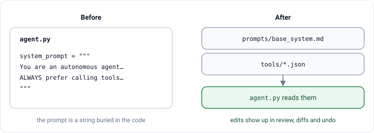

_Based on CodeSignal's course "Developing a Stateless Agent in Python", the third of four courses in its "Building a
12-Factor Agents App in Python" path. [Part 1](/engineering/12-factor-agents-1-the-twelve-principles) covers the
principles and [part 2](/engineering/12-factor-agents-2-tool-calls-and-the-agent-loop) builds the loop. Outputs are
from the lessons' own runs._

Part 2's calculator agent worked, but it lived in one script with three problems:

- The prompt was a string buried in the code.
- The model read our messy bookkeeping, full of IDs and technical fields.
- Its progress was scattered, with nothing you could save and reload.

This course fixes all three by making the agent **work like a function**: you hand it the current situation, it does
one step, and it hands back the new situation. It remembers nothing itself. The task gets harder too: solve
x² − 5x + 6 = 0.

## 1. The agent as a function (Factor 12)

Programmers call this shape a **reducer**: take the current state plus one new event, return the next state. A bank
balance works this way: last month's balance plus one transaction gives the new balance. The function remembers
nothing; everything comes in through the front door.

**Stateless** means the agent holds no memory of the run, only settings like which model to use. That gives you:

- **Pause and resume:** save the state anywhere, and any later program can pick up from it.
- **Testing:** test one step with a hand-made state.
- **Scaling:** run many copies side by side, since none hides anything.

The code splits into three small jobs: one method talks to the model, one does a single step, and one runs steps in a
loop until the task is done or the step limit is hit. Tool descriptions move into their own `.json` files, so you can
reword them without touching Python.


The result:

```text
Status: complete
Final answer: x = 2 and x = 3
```

## 2. Prompts live in files (Factor 2)

The instructions move out of Python into their own file, `base_system.md`:

```markdown
# ROLE

You are an autonomous agent that can take multiple tool-calling steps.

# REQUIREMENTS

- If your work is done, call the final_answer tool
- ALWAYS prefer calling tools to compute, fetch, or transform information rather than fabricating results.
```

Small change, big effect: prompt edits now show up in code review, can be compared, and can be undone.



## 3. Write a clean page for the model (Factor 3)

The raw history is good for record-keeping but noisy to read. So the course adds a **serializer**: a function that
turns the raw list into a short page written for the model.

![Two views of the same agent run. Left, the raw context list kept inside the program: a user message followed by pairs of function_call and function_call_output dictionaries, each with type, name, arguments and a long call_id. An arrow labelled serialize_context_to_text points right to the page the model reads: a User Request heading with the equation, an Actions Already Completed heading with five checkmarked lines such as power(base=-5, exponent=2) giving 25, and a Next Step heading. The raw list is for auditing; the page is for the model.](../../assets/images/12-factor-agents-3/raw-vs-serialized.svg)

What the model actually read on its last step:

```markdown
# User Request

Solve the root of this equation: x^2 - 5x + 6 = 0

# Actions Already Completed (DO NOT REPEAT)

✓ COMPLETED: power(base=-5, exponent=2) → Result: {"result": 25}
✓ COMPLETED: multiply_numbers(a=4, b=6) → Result: {"result": 24}
✓ COMPLETED: subtract_numbers(a=25, b=24) → Result: {"result": 1}
✓ COMPLETED: divide_numbers(a=6, b=2) → Result: {"result": 3.0}
✓ COMPLETED: divide_numbers(a=4, b=2) → Result: {"result": 2.0}

# Next Step

Decide what tool to call next to make progress on the request.
```

Like a doctor's full chart versus the short handoff note at shift change. The full record stays in your program; the
model gets the note.

The "DO NOT REPEAT" heading is there on purpose, to stop the model from re-running finished steps. That's context
engineering in practice: choosing how things are worded, not just what's included.

### A prompt asks; code enforces

Look at the steps above. The model computed 25, 24 and 1, then jumped to `divide_numbers(6, 2)`. It worked out √1,
5 + 1 and 5 − 1 in its head, even though the prompt says "ALWAYS prefer calling tools." The answer was right, but it
shows that a prompt is a request the model can ignore. Rules that must hold belong in code.

## 4. One State object (Factor 5)

The agent tracks two kinds of information:

- **Execution state:** about the run. Steps taken, running or finished, work waiting, errors.
- **Business state:** about the task. The conversation and the answer.

Like a package-tracking page: "out for delivery" is execution state; the address is business state. Factor 5 keeps
both in one object:

```python
class State(BaseModel):
    id: str
    steps: int = 0
    status: str = "running"            # running / complete / max_steps_reached / failed
    context: List[Any] = Field(default_factory=list)
    pending_tool_calls: List[Any] = Field(default_factory=list)   # work waiting to run
    error: Optional[str] = None
    final_answer: Optional[str] = None
```

![The stateless reducer with one State object. A State card on the left has an id, then execution state (steps, status, pending_tool_calls, error) and business state (context, final_answer). An arrow carries it into the agent's run method, which deep-copies it and calls _next_step until the status is no longer running, recording crashes as failed. A new State card comes out on the right with steps counted, status complete, a longer context and final_answer filled in. The original State is left unchanged.](../../assets/images/12-factor-agents-3/reducer.svg)

The agent copies the State it's given and returns a new one, so the original is never changed. (The lesson's first
version, from lesson 1, still added to the caller's list in place. It admits that's a simplification, and this copy
is the fix.) If something crashes
(the API is down, say), the run ends with `status="failed"` and the error saved, instead of blowing up. Every ending
comes back in the same object.

That's a different kind of failure from part 2. A tool error (bad input, unknown tool) goes back to the model, which
can fix it and try again. A crash like an API outage is something the model can't fix, so the run stops and records
why.

### The key change: work waits in the state

Inside each step, the order flips:


Before: ask the model, then run what it asked for. Now: run the work already waiting, then ask the model, then put its
new request in the waiting list.

Why it matters: between steps, the model's next request sits in the state, **decided but not yet done**. Save the
state then, and something outside the agent can look at that request before it runs. A log, a test, or a person who
must approve it. That's exactly what part 4 builds on.

One side effect: the final answer is handled one step after the model gives it, so a run with five tool calls uses
seven steps. Worth knowing when you set the step limit.

The agent can now stop between any two steps without losing anything. But only a Python script can run it.
[Part 4](/engineering/12-factor-agents-4-agents-behind-an-api) puts it behind a web API, adds pause and resume, and
lets it ask a person for help.
