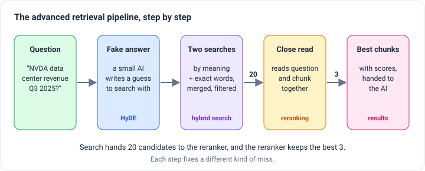
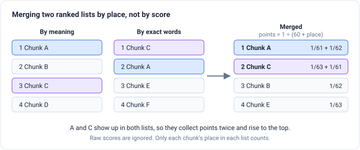
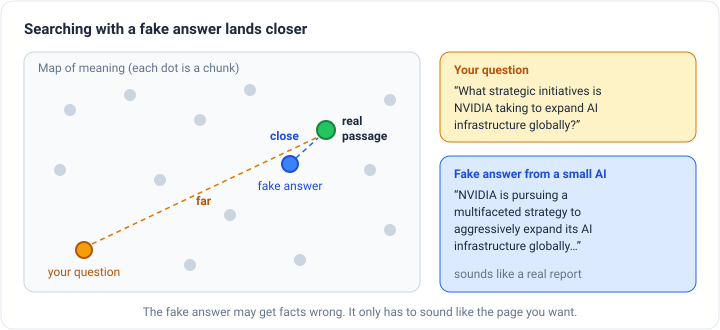
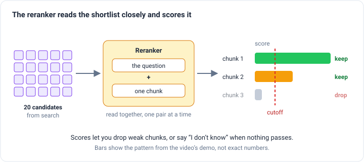
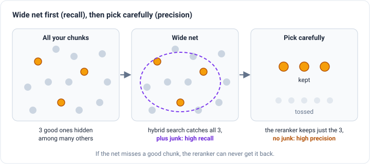

_Based on Venelin Valkov's video
[Advanced Retrieval Pipeline for RAG](https://www.youtube.com/watch?v=_ZHM4wsUwPs) (Jan 2026)._

In the [text splitting post](/engineering/five-levels-of-text-splitting), we cut documents into small pieces called
**chunks** so an AI can be handed just the pieces that answer a question. Finding those pieces is called **retrieval**.

Good chunks don't guarantee good retrieval, though. Think of a library with perfectly organized shelves and a librarian
who still brings you the wrong book. Shelves aren't the problem. The search is.

Valkov's video builds a search that misses less often. His example is a pile of company financial reports from NVIDIA,
and everything runs on one computer with no cloud services: a Postgres database and small AI models that run locally.
His pipeline stacks three tricks on top of basic search:

Each trick fixes a different kind of miss, so let's start with the misses.

## Where basic search goes wrong

Most AI search runs on **embeddings**. An embedding turns a chunk of text into a long list of numbers that captures what
it _means_. Chunks that mean similar things get similar numbers, so a search can find passages that say the same thing
in different words. Ask "how much did sales grow?" and it can find "revenue went up compared with last quarter," even
though the two sentences share no words.

That same strength is a weakness with exact labels. Ask for "NVDA Q3 2025" and a meaning-based search sees "a company's
report for some quarter of some year." The Q2 2024 report means almost the same thing, so it may hand you that one
instead. It's like asking a friend who remembers the gist of every book they've read but never the page numbers.

Anything where the exact characters matter fails this way: stock tickers, product codes, error codes, version numbers,
people's names. A smarter embedding model won't fix it, because blurring away exact details is how embeddings work.

## Trick 1: Search two ways at once

The fix for exact labels is old-fashioned **keyword search**. It works like Ctrl+F: it finds chunks that contain the
exact words in your question. It's bad at "sales" vs. "revenue," but it never confuses Q3 with Q2.

So run both searches and combine their results. This is called **hybrid search**. Each search gives back a ranked
list, best match first, and you merge the two lists into one.

Merging is trickier than it sounds. The two searches score chunks on completely different scales, like trying to
combine a test score out of 100 with a race time in seconds. Valkov's pipeline uses a method called **Reciprocal Rank
Fusion (RRF)** that skips the scores entirely and looks only at each chunk's _place_ in each list:

- A chunk earns **1 ÷ (60 + its place)** points from each list it appears in.
- Add up the points, and sort.

A chunk that shows up in both lists collects points twice, so it rises to the top. When two very different search
methods both pick the same chunk, that's good evidence it's relevant. The 60 is there so first place isn't worth far
more than second, which stops one list from overpowering the other.

### Use labels you already have

Valkov stores a few labels with every report: the company's ticker, the fiscal year, the quarter, and the report type
(a quarterly 10-Q or a yearly 10-K). The database also checks the labels when a report is saved, so a quarterly report
has to say which quarter it covers, 1 through 4. Each chunk links back to its report.

If the question is about Q3 2025 and every chunk already knows its quarter and year, you can simply filter on those
labels instead of hoping a search figures it out. It's the same idea as limiting a search to one chapter, which the
[preprocessing post](/engineering/preprocessing-unstructured-data) covers.

## Trick 2: Search with a fake answer (HyDE)

Questions and answers look different. The chunks in your library are statements, often several sentences long. A
question is short, and Valkov points out that real questions are often too short, too long, or just plain wrong. So
even the chunk that answers a question perfectly might not land close to it in meaning.

**HyDE**, short for Hypothetical Document Embeddings, flips the problem around. Before searching, you ask an AI to
write a paragraph that _answers_ the question, and then you search with that paragraph instead of the question. It's
like describing to a librarian what the page you want would say, instead of asking them a question.

The fake answer will probably get facts wrong, and that's fine, because nobody reads it. Its only job is to _sound like_
the real passage: written as statements, using the same kind of vocabulary, about the same length.

In the video, the question is "What strategic initiatives is NVIDIA taking to expand AI infrastructure globally?" A small
local model, Gemma 3 with 4 billion parameters, wrote a fake answer that begins "NVIDIA is pursuing a multifaceted
strategy to aggressively expand its AI infrastructure globally…" Searching with that paragraph changed the results:
the data center chunk moved to the top, and the third result was a different chunk than before. The demo only has a
handful of chunks, so treat this as a picture of the idea rather than proof that it works better.

Three things to watch:

- **Only the meaning search should use the fake answer.** The fake paragraph is full of made-up details. Give keyword
  search the original question, or it will hunt for exact words that were never in your documents.
- **Use a model that writes sensibly.** Valkov warns that a model too tiny to write a coherent paragraph produces
  gibberish, and searching with gibberish finds gibberish.
- **It costs time.** HyDE adds a whole AI writing step before the search even starts.

## Trick 3: Read each candidate closely (reranking)

The first search is fast for a reason. Every chunk's numbers are worked out once, ahead of time, and each question is
just compared against them. That's like skimming a stack of résumés: quick enough for millions of chunks, but shallow,
because the question and the chunk are never actually read together.

A **reranker** does the slow, careful version. It takes the question and one chunk, reads them side by side, and gives a
score for how well that chunk answers that question. This is more like a job interview: far more accurate, and far too
slow to give to everyone. So you only interview the shortlist. In Valkov's pipeline, search hands over 20 candidates
and the reranker keeps the best 3. (The technical name for this kind of model is a _cross-encoder_.)

He uses a library called FlashRank with a small model called ms-marco MiniLM. He calls it fine for quick demos and
suggests a stronger one, such as Qwen3 Reranker with 600 million parameters, for real use.

The scores are what make the reranker so useful. In the demo, a question about "partnerships with major technology
companies for AI infrastructure" gave three chunks: the first scored very high, the second about half as high, and the
third so low that Valkov says to ignore it. The full pipeline showed the same pattern: one very relevant data center
chunk, one a little weaker, and one he called highly irrelevant.

Basic search can't do that. It always returns its top few results, even when nothing in your library answers the
question, because the closest chunk is still the closest. A reranker's score lets you set a **cutoff**, so when nothing
clears it, the system can answer "I don't know" instead of building an answer from junk. To pick the cutoff, score a few
chunks you know are irrelevant and see where they land. Each reranker model needs its own cutoff.

One more catch: a reranker only reads up to a maximum length. If a chunk is longer, the end gets cut off, and if the
answer was in the part that got cut, the chunk scores low. Valkov's advice is to raise that limit as far as your
computer can handle.

## Wide net first, then pick carefully

Two words help explain how the tricks fit together:

- **Recall:** of all the chunks that would help, how many did you find?
- **Precision:** of the chunks you handed over, how many actually help?

Valkov's summary says hybrid search brings precision and the reranker improves recall. I think it's the other way
around, and the difference matters when you tune the pipeline.

Picture fishing. Hybrid search is a wide net. It brings in every good fish plus a lot of old boots, which means **high
recall**. The reranker sorts the catch and keeps only the good fish, which means **high precision**. And sorting can
never add a fish the net missed. If the right chunk wasn't in the 20 candidates, no reranker can bring it back.

So cast the net wide on purpose. Fetching 20 candidates to keep 3 isn't waste, it's the whole design. The common mistake
is fetching 5 and reranking 5. Then the reranker can only shuffle a list that was already missing things.

DeepLearning.AI's
[Advanced Retrieval for AI with Chroma](https://www.deeplearning.ai/short-courses/advanced-retrieval-for-ai/) course
shows this on a small scale. It fetches 10 chunks instead of 5, reranks, and keeps 5. Two chunks from places 6 and 7
move into the top five, and a search that only fetched 5 would never have found them.

## Where to start

You don't need all three tricks on day one. In order of payoff for the effort:

1. **Hybrid search.** It fixes a real, common miss with exact labels like tickers and codes, and running the two
   searches at the same time adds almost no waiting.
2. **Reranking.** It's the biggest quality boost, and the only step that lets your system say "nothing found."
3. **HyDE.** It helps most with short or vague questions. It's also the slowest step, since it adds an AI writing call
   before the search starts, so it's the first thing to drop if your app feels slow.

Every step can also go wrong quietly. A reranker can cut off the end of a chunk, or a fake-answer model can drift into
nonsense, and nothing will throw an error. Valkov's closing point is a good one: the pipeline is simple to run, but it
has a lot of moving parts, and you need to keep an eye on each of them before you trust it.

I haven't tried this on documents of my own yet, so there are no test results here. When I do, I'll write up how I
measured it. For two more ways to improve search without rebuilding your library, see the
[query-side retrieval post](/engineering/query-side-retrieval).
