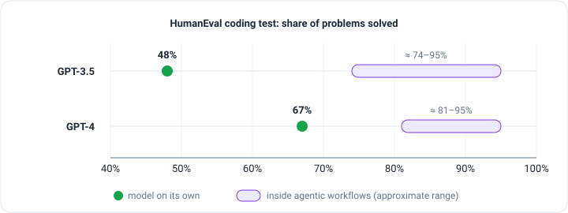
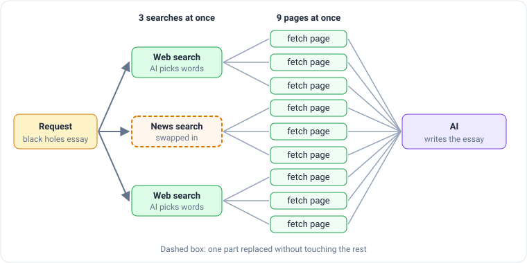

_Based on DeepLearning.AI's [Agentic AI](https://www.deeplearning.ai/courses/agentic-ai/) course, taught by Andrew Ng.
This is part 1 of 5, one post per module._

Imagine writing an essay from the first word to the last without ever pressing backspace. No outline, no going back,
no second draft. Most people would write a pretty bad essay that way.

That's how we usually use an AI chatbot. We type "write an essay about X" and it writes the whole thing in one go. AI
models are surprisingly good at this, but they do better when they work the way a person does: plan, look things up,
write a draft, read it over, and fix it.

## What makes it "agentic"

The course's definition is simple: **an agentic workflow is a process where an AI app does several steps to finish a
task.** Instead of one big request, the job is split up:

Not every step has to be the AI. Some steps use a **tool**, an ordinary program like a web search. Some steps can even
be a person, for example someone who checks the key facts before the final version.

The word _agentic_ is an adjective on purpose. People used to argue about whether a system was a "real" AI agent or
not. Ng's view is that systems can be agentic to different degrees, so the more useful question is _how much_.

## How much freedom to give the AI

Here's the same essay task, built two ways:

- **Less autonomous.** The programmer decides every step and its order. The AI only writes text: the search words and
  the essay.
- **Semi-autonomous.** The AI makes some choices, like which of the tools you gave it to use.
- **Highly autonomous.** The AI decides the steps itself, and may even write new tools as it goes. The programmer no
  longer knows in advance what will happen.

You might expect the high end to be the goal. Ng says the opposite: **most of the useful work done today sits at the
less autonomous end.** It's easier to control and easier to predict. Highly autonomous agents are exciting, but they're
still being figured out.

## Does it actually help?

Yes, and by a lot. The course shows results on **HumanEval**, a test where an AI writes short programs and gets checked
on how many of the problems it solves correctly.

Used on its own, the older GPT-3.5 solved 48% and the newer GPT-4 solved 67%. But when GPT-3.5 worked inside agentic
workflows (writing code, testing it, fixing it), it scored higher than GPT-4 did alone. How you set up the work can
matter more than which model you use.

Two more benefits come from splitting a job into steps:

- **Speed.** A person reads search results one at a time. A workflow can run three searches and download nine pages
  at the same moment.
- **Swappable parts.** Each step is its own piece, so you can swap one out, like a different search engine, a news
  search, or a different AI model for the writing, without rebuilding everything else.

## Easier jobs and harder jobs

Some jobs are a great fit for agentic AI right now. Others are still hard.

**Processing invoices** is on the easy end. Every invoice goes through the same steps: turn the PDF into text, have
the AI find four things (who sent it, their address, the amount, the due date), and save them. The steps never
change, so it works reliably.

**Answering a customer email** is a bit harder. Say someone writes, "I ordered a green desk lamp but you sent me a blue
one." The AI finds the order number, a tool looks up the order, and the AI drafts a reply. But a person reads the
reply before it goes out. Deciding where the AI stops and a person takes over is part of the design.

Further along, an AI handling _any_ customer question has to figure out the steps on the fly, because "Can I return
this?" and "Where's my package?" need different steps. And an AI that uses a web browser like a person, clicking
through an airline site to check seats, works sometimes but still gets stuck on slow or confusing pages.

The pattern:

| Easier                              | Harder                                  |
| ----------------------------------- | --------------------------------------- |
| A clear, step-by-step process       | Steps not known ahead of time           |
| There's already a written procedure | The AI has to plan and solve as it goes |
| Text only                           | Pictures, sound, live web pages         |

If a business already has written instructions for a task, most of the design is done. You're teaching the AI a
process that already exists.

## The main skill: breaking a job into steps

Ng calls this the most important skill in the whole course. Split the task into steps, then ask about each one:

> Can this step be done by an AI, by a short piece of code, or by a tool?

If yes, build it. If no, ask how a person would do that step, and split it smaller.

You rarely get it right the first time. Ng's own essay writer went through rounds:

1. **One prompt.** The essay only covered the obvious points.
2. **Outline, then search, then write.** Better, but the essays felt choppy, as if separate pieces were glued
   together.
3. **Split "write" into draft, review, revise.** Now one step's whole job is to find choppy parts and fix them.

Each round, you look at what came out, find the weakest step, and split _that_ step further. To know whether a change
actually helped, you also need a way to measure the results. The course covers that in module 4.

Here's what you can build steps from:

| Building block      | What it's for                                             |
| ------------------- | --------------------------------------------------------- |
| AI language models  | Writing text, choosing tools, pulling facts out of text   |
| Other AI models     | Turning PDFs into text, text into speech, reading images  |
| Tools that call out | Web search, live data, sending email, checking a calendar |
| Looking things up   | Searching a database or a set of documents (RAG)          |
| Running code        | Doing math, analyzing data                                |

## Four patterns for the rest of the course

The remaining modules each cover one way to design agentic workflows:

1. **Reflection.** The AI looks over its own work and improves it.
2. **Tool use.** The AI decides which tools to call, like search or running code.
3. **Planning.** The AI decides the steps itself, instead of the programmer.
4. **Multi-agent.** Several AIs, each with its own role, work together like a team.

The first two fit inside a workflow the programmer still controls. The last two hand more of the control to the AI,
which moves you along the scale toward highly autonomous.

The big idea from module 1: an agentic workflow isn't a magic new kind of AI. It's a job split into steps, with the
AI doing some of them. [Module 2](/engineering/agentic-ai-module-2-reflection) starts with the first pattern,
reflection.
