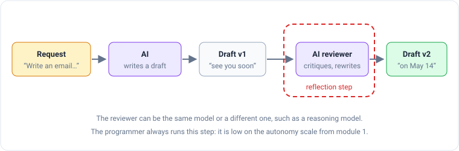
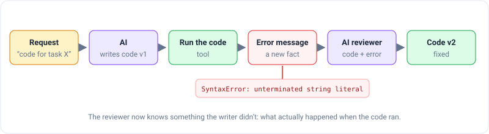
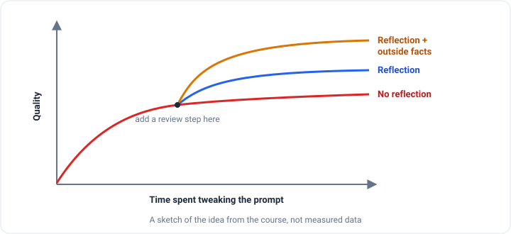
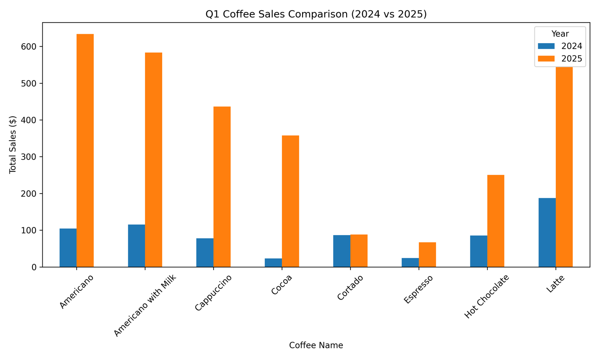
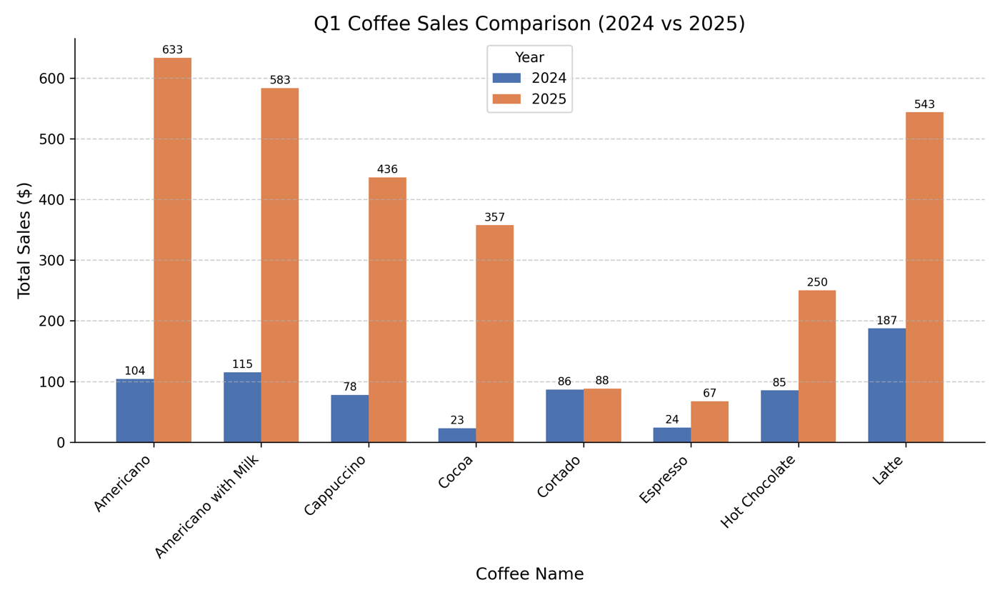

_Based on DeepLearning.AI's [Agentic AI](https://www.deeplearning.ai/courses/agentic-ai/) course, taught by Andrew Ng.
This is part 2 of 5. [Part 1](/engineering/agentic-ai-module-1-what-makes-a-workflow-agentic) explains what makes a
workflow agentic._

Before you send an important email, you probably read it over once. You notice that "see you soon" is vague and change
it to "see you on May 14." You fix a typo. Then you send the better version.

Asking an AI to do the same thing, read its own work and improve it, is called **reflection**. It's the first of the
four design patterns from module 1, and the easiest to build. The hard part is knowing when it actually helps.

## How reflection works

Reflection is just two AI calls in a row:



1. Ask the AI for a first draft.
2. Give that draft back to an AI with a different request: "Review this draft and write a better version."
3. Use the second version.

The reviewer doesn't have to be the same model. Ng often uses a fast model to write the draft and a **reasoning
model**, one that "thinks" step by step before answering, to review it. Reasoning models are good at spotting bugs.

Two tips for the review request:

- **Say it's a review.** "Review this first draft of an email" works better than just "improve this."
- **Give a checklist.** For brainstorming product names, you might ask: "Is each name easy to say? Does it mean
  something bad in any language? Keep only the names that pass."

## Does it help?

Researchers tested this in a paper called **Self-Refine** (Madaan et al., 2023). They compared plain prompting against
prompting plus a review step. Plain prompting here means **zero-shot**: the request has no worked examples in it. (A
**one-shot** prompt includes one example, and **few-shot** includes several.)


Reflection helped on almost every task, sometimes by a lot. Look at the bottom bar, though. On math, GPT-4 gained just
0.2 points. My guess at why: if the model gets a math problem wrong, rereading its own answer doesn't tell it anything
new. It made the mistake because it believed the wrong answer, and it still believes it. Ng's own expectation is
similar: reflection usually gives a modest improvement, not a miracle.

## The secret ingredient: a fact from outside

Reflection gets much stronger when the reviewer receives **new information from outside the model**. The most common
case is code. Instead of just rereading the code, you run it, and give the reviewer whatever happened:



The error message is something the writer never saw. Now the reviewer isn't guessing whether the code works. It
_knows_ it doesn't, and it knows where.

The outside fact usually comes from a small, ordinary piece of code:

| Problem                                         | Where the outside fact comes from       |
| ----------------------------------------------- | --------------------------------------- |
| The code doesn't work                           | Run it and capture the output or error  |
| An email mentions a competitor by name          | Search the text for competitor names    |
| An essay says the Taj Mahal was "built in 1648" | Web search: started 1631, finished 1648 |
| A product description is too long               | Count the words                         |

The word count is my favorite because it's so simple. AI models are still bad at hitting an exact length. A one-line
counter that says "you're at 340 words, the limit is 250" hands the model a fact it can't work out for itself.

Ng draws the payoff like this:



Tweaking your prompt helps for a while, then stops paying off. That's the moment to add a review step, and better
still, to find a source of outside facts for it.

## Lab 1: an AI that looks at its own chart

The first lab asks for a chart: _compare coffee sales in the first three months of 2024 and 2025_, using sales data from
a coffee vending machine.

1. `gpt-4o-mini` writes Python code to draw the chart.
2. The code runs and saves the chart as an image.
3. `o4-mini`, a reasoning model that can see images, gets the **picture** plus the code, and is asked for feedback and
   new code.
4. The new code runs and makes chart v2.

The key detail is step 3: the reviewer looks at the actual chart, which the writer never saw. Here's my v1:



The reviewer's feedback:

> The original chart relies on pandas' default styling, resulting in generic colors, no grid lines or value
> annotations, and a cluttered legend.

It's right about the legend: it covers the 2025 Latte bar. Version 2 added numbers on every bar, a light grid, and moved
the legend out of the way:



V2 is clearly easier to read. The numbers show that Cocoa jumped from 23 to 357 while Cortado barely moved, from 86 to 88. But v1 was already the right kind of chart. In the lecture, v1 was a stacked bar chart that was hard to compare, so
the fix was much bigger. Reflection can only fix what v1 got wrong, and how much v1 gets wrong changes from run to run.

When I ran the lab again later, the first draft didn't even run. The prompt said the data was already loaded, but the
model wrote code to load the file again. The raw file is missing the `year` column the lab adds, so the code crashed.
The lab sent the error message back to the model for one retry, and the retry crashed the same way. So an outside fact
is necessary but not magic. The notebook also kept showing an old v1 chart from an earlier run, which made it look
like everything had worked. If you try this yourself, delete the old images before rerunning.

## Lab 2: the bug only the result could reveal

The second lab uses a store's database. Every row records one event: a new product, a restock, a sale, or a price
change. One detail matters a lot: when an item sells, its quantity is stored as a **negative number**, because stock
went down.

The question: _which color of product has the highest total sales?_ The AI wrote this database query:

```sql
SELECT color, SUM(qty_delta * unit_price) AS total_sales
FROM transactions WHERE action = 'sale'
GROUP BY color ORDER BY total_sales DESC LIMIT 1;
```

In plain words: for every sale, multiply quantity by price, add them up per color, and return the biggest. That sounds
right. But every quantity is negative, so every total is negative, and "the biggest" negative number is the one closest
to zero. The query picked the color that sold the _least_. It answered **blue, −190,571.46**.

**Review with only the query.** `gpt-4.1` read the question, the query and the table's column list. Its verdict: the
query "fully answers the user's question." Nothing in the column list says sales are negative, so the reviewer made the
same assumption as the writer.

**Review with the query's result.** Same request, plus the one-row answer. This time:

> The total_sales value is negative, which suggests that qty_delta is negative for sale actions, as is common in
> inventory systems... the absolute value of qty_delta should be used.

The fixed query uses `ABS(...)`, which drops the minus sign, and answers **white, 358,315.09**. The model didn't get
smarter between the two calls. It got a fact it didn't have before: a negative total.

## How do you know reflection helped?

Every review step adds another AI call, which costs time and money. So before keeping it, measure it.

**When there's a right answer**, build a small test set: 10 to 15 questions where you already know the answer. Run each
one with and without reflection, and count how many come out right. Ng's example from the store database:

| Question                 | Right answer    | Without reflection | With reflection |
| ------------------------ | --------------- | ------------------ | --------------- |
| Items sold in May 2025?  | 1201            | 980                | 1201            |
| Most expensive item?     | Airflow sneaker | Airflow sneaker    | Airflow sneaker |
| How many styles carried? | 14              | 14                 | 14              |

Rerun the test every time you change the review prompt, so you know whether the change helped.

**When there's no right answer**, like "which chart is better?", you might ask another AI to compare v1 and v2. Ng
warns that this works poorly. The verdict changes with small wording changes, it often disagrees with human experts,
and many models just pick whichever option they were shown first. That last one is called **position bias**.

What works better is grading **one** chart at a time against a **yes/no checklist**:

1. Does it have a clear title?
2. Are the axes labeled?
3. Is it the right kind of chart?
4. Do the axes use a sensible range of numbers?

Add up the yeses. AI models are inconsistent when asked to "rate this from 1 to 5," but much steadier on simple yes/no
questions. In Ng's example, charts scored 4, 5 and 5 points without reflection and 6, 8 and 7 with it.

The big idea from module 2: writing the review step is easy. What matters is what you give the reviewer. If it only
sees what the writer saw, it tends to make the same mistakes. Hand it something new, like an error message, a picture,
a word count or a search result, and it can actually catch them.
[Module 3](/engineering/agentic-ai-module-3-tool-use) is about tool use, which lets the AI go and get those facts on
its own.
