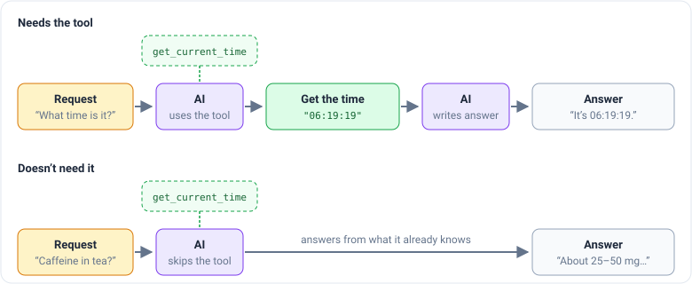
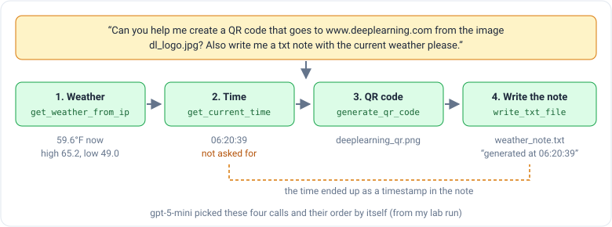
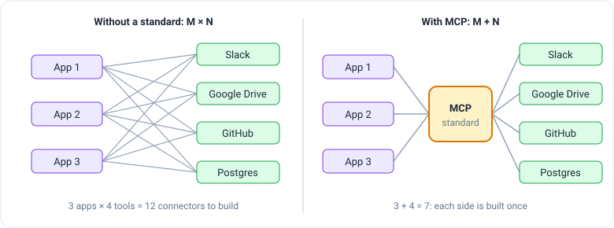

_Based on DeepLearning.AI's [Agentic AI](https://www.deeplearning.ai/courses/agentic-ai/) course, taught by Andrew Ng.
This is part 3 of 5. [Part 2](/engineering/agentic-ai-module-2-reflection) covered reflection._

Ask an AI chatbot "what time is it?" and, on its own, it can't know. It learned from text collected months ago and has
no clock. The best it can do is say "sorry, I don't have access to the current time."

People are much more capable with tools than with bare hands, and AI is the same. Give the AI a small function that
reads the clock, and it can answer. Module 3 is about **tool use**: handing the AI functions it can ask to use, and
letting it decide when.

## The AI decides when to use a tool

In the course's first lab, the AI (`gpt-4o`) gets one tool, `get_current_time`. Asked "What time is it?", it answered
"The current time is 06:19:19." (The lab's servers run on Greenwich time, which is why it's so early.)

The important part is that the tool is **optional**. Ask the same AI, with the same tool, how much caffeine is in green
tea, and it just answers. It never touches the clock.

This is a step up the autonomy scale from module 1. Before, the programmer wrote "always run a web search here." Now the
programmer says "here are some tools, use them if you think you should," and the AI makes the call.

## How a tool call really works

"The AI uses a tool" is a slight lie. The AI can't run anything. It can only write text. So what actually happens is:

1. Along with the question, the AI receives a short **description** of each tool: its name, what it does, and what
   information it needs. For example: `get_current_time` returns the current time for a time zone like
   `Pacific/Auckland`.
2. If the AI decides a tool would help, it replies with a **request** instead of an answer: "please run
   `get_current_time` with `Pacific/Auckland`."
3. Your program sees the request, runs the real function, and sends the result back.
4. Now the AI has the fact it was missing, and it writes the final answer.

You can see step 2 in the lab's raw output. The AI's reply has no text at all. Its content is empty, and instead it
lists one `tool_calls` entry naming `get_current_time`, with the reason for stopping marked as `"tool_calls"`.

Since the description is all the AI knows about a tool, it matters a lot. A clear one-line description is how the AI
tells your tools apart.

## Picking from many tools, and chaining them

Next, the lab gives `gpt-5-mini` four tools: get the time, get the weather, write a text file, and make a QR code. Each
request got the right tool:

- "Can you get the weather for my location?" → the weather tool, which reported 59.6°F with a high of 65.2°F.
- "Make a txt note called reminders.txt that reminds me to call Daniel tomorrow at 7PM" → the file tool, with the
  file name and the sentence filled in from the request.
- "Make a QR code using my company's logo that goes to www.deeplearning.ai" → the QR tool.

Here's that QR code. The real one had the course's logo in the middle. This copy was made with the same library,
settings and link, minus the logo:

The most interesting run asked for two things at once:

Nobody wrote that order. The AI planned it from the request. It even looked up the time without being asked, and used it
to stamp the note "generated at 06:20:39."

One small thing I noticed: the lab's request says `www.deeplearning.com`, not `.ai`. The AI made the QR code for
exactly what it was told. A tool does what the request says, so a mistake in the request becomes a mistake in the
result.

## The tools you give are the only things it can do

The second lab is an **email assistant** working on a practice inbox. It gets tools like "list unread emails," "search
emails," "mark as read," and "send email." Here's what happened with three requests:

| Request                                                                                 | Tools available   | What the AI did                                                                         |
| --------------------------------------------------------------------------------------- | ----------------- | --------------------------------------------------------------------------------------- |
| "Check for unread emails from my boss, mark them as read, and send a polite follow-up." | No delete tool    | Find unread from boss → mark as read → send a reply about the quarterly report          |
| "Delete Alice's email"                                                                  | No delete tool    | Found the email, then said "I can't delete emails" and offered to mark it read or reply |
| "Delete Alice's email"                                                                  | Delete tool added | Search → delete. "Done — I found and deleted the email from alice@work.com."            |

The middle row is the lesson: without the right tool, the AI can still think about the task, but it can't do it. The
list of tools is the list of things your agent is able to do.

One thing I'd change before using this on a real inbox. The lab's prompt tells the AI "never ask the user for
confirmation before performing an action." That's fine for a practice inbox. For real deletions, I'd want a person to
approve, like the human sign-off step in module 1.

## When no tool fits, let the AI write code

Imagine building a calculator assistant. You make tools for add, subtract, multiply and divide. Then someone asks for
the square root of 2. You add a square root tool. Then someone needs powers, then logarithms. A scientific calculator
has a lot of buttons.

The alternative is one very general tool: **let the AI write code, and run it.** The AI writes a couple of lines of
Python, your program runs them, and the printed result goes back to the AI. That handles the square root and almost
anything else you could ask a calculator.

This also connects to module 2. If the code crashes, send the error message back and let the AI fix it. The error is
exactly the kind of outside fact that makes reflection work.

Running code that an AI wrote does carry some risk. Ng shared a real story: a coding agent decided to delete all the
Python files in a project folder, then apologized for "an incredibly stupid mistake." The project was backed up, so
nothing was lost. The safe habit is to run AI-written code in a **sandbox**, a sealed-off space where a bad command
can't reach your real files or passwords.

## MCP: sharing tools instead of rebuilding them

So far, every app writes its own tools. But many apps need the same ones: Slack, Google Drive, GitHub, a database. If
three apps each build their own connector to four services, that's twelve connectors, and most of them are copies.

The **Model Context Protocol (MCP)**, proposed by Anthropic and now used by many companies, is a shared standard for
this. A service like GitHub offers its tools once, as an **MCP server**. Any app that speaks MCP, an **MCP client**, can
use them. Instead of every app times every tool, you build each side once.

In the course demo, a desktop AI app connected to a GitHub MCP server could summarize a project's README and list its
latest changes, using tools that the person asking never wrote.

The big idea from module 3: the AI never acts directly. It asks, and your code decides whether to run it. That makes
the list of tools you hand over the most important design choice, both for what your agent can do and for what it
can break. [Module 4](/engineering/agentic-ai-module-4-evals-and-error-analysis) is about measuring whether an agent
is working, which Ng calls possibly the most important module in the course.
