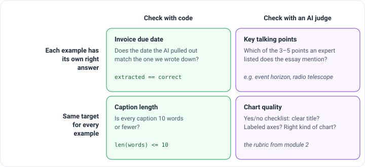

_Based on DeepLearning.AI's [Agentic AI](https://www.deeplearning.ai/courses/agentic-ai/) course, taught by Andrew Ng.
This is part 4 of 5. [Part 3](/engineering/agentic-ai-module-3-tool-use) covered tool use._

When an agent gives a bad answer, the tempting move is to guess which part is broken and start fixing it. Teams that
work this way can spend months improving a step that was never the problem. Ng says the biggest difference between
teams that build agents efficiently and teams that struggle is a disciplined way of finding what's actually wrong. He
calls this possibly the most important module in the course.

The process is a loop between two activities:

- **Build:** make a quick first version of the whole system, then improve one part at a time.
- **Analyze:** read the outputs, measure them, figure out which step caused each problem, and test that step alone.

## Build first, then look

It's hard to predict where an agent will struggle, so Ng's advice is not to spend weeks planning. Build a rough version
quickly (without leaking anyone's data), then read what it produces.

Take the invoice reader from module 1. Run 20 invoices through it and note what went wrong with each. Invoice 1 is fine.
Invoice 2 mixed up the invoice date with the due date. Invoices 3 and 4 are fine. If date mix-ups keep showing up,
you've found your most common problem, and you know what to measure next.

## Scoring the final output

An **eval** (short for evaluation) is a repeatable test that gives your system a score. You change something, rerun
the eval, and see whether the score went up. To start, you only need 10 to 20 examples.

Evals come in four flavors, depending on two questions: can plain code check the answer, or do you need another AI to
judge it? And does each example have its own right answer, or do they all share one target?

- **Invoice due date.** Write down the correct due date for each test invoice. Code compares the AI's date with yours.
- **Caption length.** A marketing assistant should write captions of 10 words or fewer, but keeps writing 14 or 17.
  Code just counts the words. The target is the same for every example.
- **Key talking points.** For a research agent, an expert lists 3 to 5 points each essay should cover. For black holes,
  that might include the event horizon and radio telescopes. Code can't check this, because there are too many ways to
  say the same thing, so an AI judge counts how many points appear.
- **Chart quality.** The yes/no checklist from module 2.

These all score the **final output** of the whole system, which is called an **end-to-end** eval. Two tips from Ng:

- **The eval can be wrong too.** If you're sure a change made things better and the score didn't move, fix the eval:
  add examples or change how it scores.
- **Compare with people.** Most agents automate a job people already do. Wherever the agent falls short of an expert
  is where to work next.

## Finding the broken step

An end-to-end eval tells you the research agent's essays are missing things. It doesn't tell you why. Almost every
step is a suspect:

To find out, read the **trace**: everything each step produced during one run. In Ng's black hole example, the search
terms look like what an expert would type. But the search results include a kids' news site with a story about an
elementary school student cracking a black hole mystery. Most results are blogs and popular news, not science.

Doing this for one essay is a story. Doing it for many is **error analysis**:

1. Collect only the bad outputs.
2. For each one, mark every step that did noticeably worse than an expert would have **with the same input**.
3. Count.

The "same input" part matters. If the search results were all weak, the next step isn't to blame for picking weak
sources. It did the best it could with what it was given.

In the course's research example, search results were at fault in 45% of bad essays, picking sources in 10%, and
search terms in only 5%. So the place to work is the search engine. For the invoice reader, the count was even more
lopsided: the PDF-to-text step caused 15% of wrong dates, but the AI picking the date caused 87%. A team that guessed
"the PDF conversion must be garbling dates" could have spent weeks on the wrong step.

The count is half the decision. The other half is whether you have ideas for fixing that step. A step that causes many
errors and that you know how to improve goes to the top of the list.

## Testing one step on its own

Once you know which step to fix, rerunning the whole agent after every change is slow, costs money, and is noisy:
randomness in the other steps can hide a small improvement. So build a **component-level eval** that tests just that
one step.

For web search, an expert lists good sources for a handful of topics, and code checks how many search results come
from that list. Now you can try another search engine or change the number of results, and see the effect right away.

The course's lab builds a simple version of this. The research step searches for papers, and the eval checks whether
the links come from a list of preferred websites like `arxiv.org`, `nature.com` and `nasa.gov`. If at least 40% do, it
passes. Here's what happened when I ran it:

| Request                                      | What came back                                                                                  | Eval score         |
| -------------------------------------------- | ----------------------------------------------------------------------------------------------- | ------------------ |
| "Find 2 recent papers" about black holes     | Two arXiv papers from **2006 and 1998**                                                         | 4 of 4, 100%, PASS |
| "Find 2–3 key papers and reliable overviews" | Three arXiv papers from 1998–2008, plus Harvard's astrophysics center, ScienceDaily and YouTube | 7 of 9, 78%, PASS  |

Both runs passed. But the first request asked for _recent_ papers and got ones from 1998 and 2006. The AI even admitted
it: "Unfortunately, these papers are not recent." The eval passed anyway, because it only checks where links point,
not how old the papers are. It also counted each paper twice, since every paper had an abstract link and a PDF link.

This is Ng's "the eval can be wrong too" tip in action. Reading the output says the result is bad, and the score says
it's perfect. When they disagree, fix the eval. Here I'd add a date check and count each paper once.

Once the component eval is trustworthy, there are several ways to improve the step itself. For tools like search,
adjust settings such as the number of results or the date range, or switch providers. For AI steps, roughly from
cheapest to most expensive: improve the prompt, try a different model, split one overloaded step into two simpler ones,
or, for a mature system that's stuck, train the model further on your own examples (**fine-tuning**). Afterwards,
rerun the end-to-end eval to confirm the improvement carried through to the final result.

## Speed and cost come last

Ng's order is clear: get the quality right first, because that's usually the hardest part. Then, if the agent is too
slow or too expensive, use the same trick as error analysis. Measure each step, and work on the biggest one.

**Time.** Writing the essay is the slowest step at 18 seconds. Options: run independent steps at the same time (like
fetching pages in parallel), try a smaller and faster model for a slow AI step, or use a provider with faster hardware.

**Cost.** The surprise is that the AI steps are cheap. Picking search terms costs $0.0004, while one web search costs
$0.016, 40 times as much. The most expensive step is converting fetched PDFs to text, at $0.03. Switching the first AI
step to a cheaper model would save almost nothing. PDF conversion is about half of the whole bill, so that's where a
cheaper option would actually matter.

That's the useful part of measuring: it shows where to optimize, and also which parts aren't worth worrying about.

The big idea from module 4: don't guess. Read the outputs, count which step causes the problems, and test that step on
its own. Keep checking that your eval agrees with your own judgment, because a score that says "PASS" on 1998 papers
isn't measuring what you care about.
[Module 5](/engineering/agentic-ai-module-5-planning-and-multi-agent-systems) covers the last two patterns, planning and
multi-agent systems.
