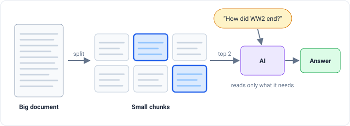
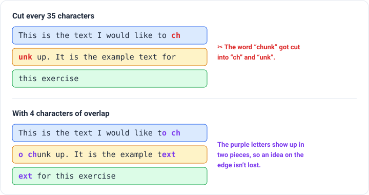
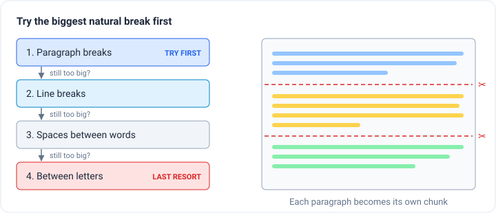
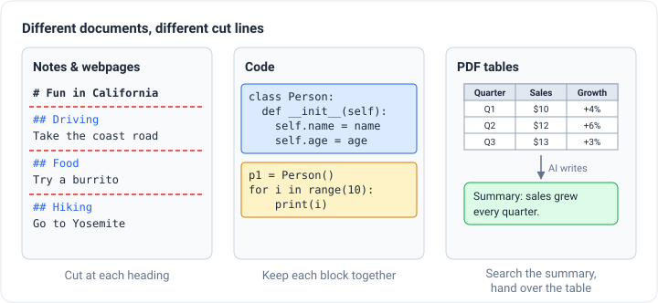
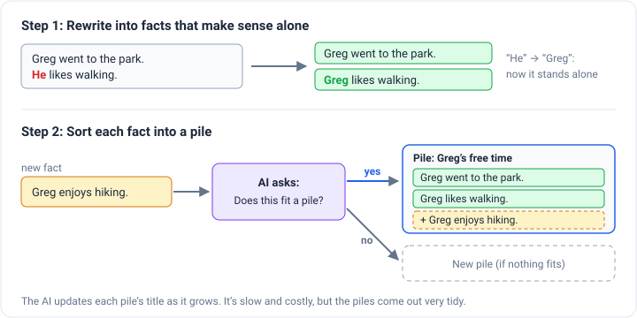
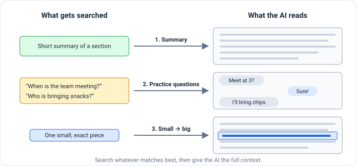
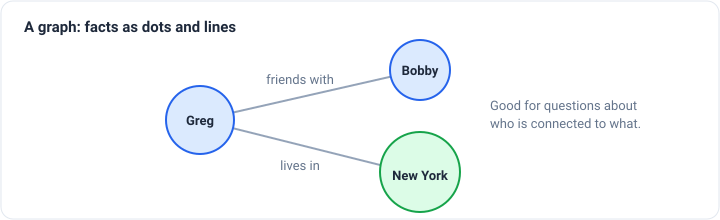

_Based on Greg Kamradt's video
[The 5 Levels Of Text Splitting For Retrieval](https://www.youtube.com/watch?v=8OJC21T2SL4) and its notebook._

Say you have an open-book test, but you can only bring one index card. You wouldn't copy the first few pages of your
textbook onto it. You'd find the parts the test will probably ask about and write down exactly those.

AI apps that answer questions about your own documents work much the same way. People call this **retrieval**. The AI
can't read your whole library every time you ask something. Your app has to find the few pieces of text that matter and
hand only those over.

Before it can find those pieces, it needs pieces to find. Cutting a big document into smaller parts is called **text
splitting** or **chunking**, and it's one of the first and most important choices you make when you build one of these
apps.

## Why not just give the AI everything?

There are two reasons.

1. **AI models have a reading limit.** Each model has a maximum amount of text it can take in at once, called its
   _context window_. Go past it and the model simply can't take the rest.
2. **Extra stuff makes the AI worse.** Even under the limit, unrelated text distracts the model. If someone asks about
   World War II, handing over a chapter that also covers cooking and car repair just adds noise. You want a high
   **signal-to-noise ratio**: lots of useful information and very little else.

Greg has a rule he calls the **chunking commandment**:

> Your goal isn't to chunk for the sake of chunking. Your goal is to get your data into a shape that can be found and
> used later.

Keep that in mind, because every level below is a different way of following it.

## Level 1: Cut every N letters

The simplest method is to pick a number, say 35 characters, and cut the text every 35 characters no matter what.

It's like running a long scroll through a paper cutter at fixed intervals. It's fast and easy. But it doesn't care what
the text says, so it cuts words in half and splits sentences mid-thought.

Level 1 introduces two ideas that matter at every level:

- **Chunk size** is how big each piece is.
- **Chunk overlap** is how much each piece repeats from the end of the one before it. Think of roof shingles laid so
  each one covers the edge of the last. If an important idea lands right on a cut, the overlap makes sure it shows up
  whole in at least one piece.

Here's what both look like on a real sentence:

Almost nobody uses Level 1 in real products. It's mainly useful for learning the basic ideas. If you want to play with
it yourself, [ChunkViz](https://www.chunkviz.com/) lets you slide the size and overlap and watch the cuts move.

## Level 2: Cut at natural break points

Writing already has places where it's okay to cut: paragraph breaks, line breaks, the spaces between words.

Level 2, called **recursive character splitting**, uses them in order. It tries the biggest break first and only moves
down the list when a piece is still too big.

It's like slicing a cake along the lines already marked on the frosting, and only cutting through a decoration when you
have to.

Writers usually keep one idea per paragraph, so this method tends to keep ideas together. Greg calls it the Swiss Army
knife of splitters: **if you don't know where to start, start here.**

## Level 3: Cut based on what kind of document it is

Not everything is an essay. A recipe, a computer program, a webpage and a PDF full of tables are each organized
differently, so each one has its own natural break points.

- **Formatted notes and webpages:** cut at section headings, so "Driving" and "Hiking" end up in separate pieces.
- **Computer code:** cut where each block of related code starts, so a block stays together instead of being split
  mid-thought.
- **Tables in PDFs:** cutting a table by letters scrambles it. Instead, special tools pull out the whole table and keep
  its rows and columns intact. A handy trick: **have an AI write a short summary of the table**, and search the
  summaries. When a summary matches the question, hand the AI the full table.
- **Images:** a search system can't search a picture by its words, because it doesn't have any. One fix is to have an AI
  that can see images write a description of each one, and search those descriptions.

The main lesson of Level 3 is that **the right way to split depends on what the data looks like.**

## Level 4: Cut where the topic changes

The first three levels share a problem. They look at _where_ the text sits and how it's formatted, but not at _what it
means_. Greg compares it to organizing a library by how big the books are instead of what they're about.

Level 4, called **semantic splitting**, tries to cut based on meaning. It uses **embeddings**.

An embedding turns a piece of text into a list of numbers that act like coordinates on a map of meaning. Sentences about
similar things land close together. Sentences about different things land far apart.

Level 4 works like this:

1. Break the text into sentences.
2. Pair each sentence with its neighbors so it has a little context.
3. Place each group on the meaning map.
4. Walk through the text one step at a time and measure how far the meaning jumps between neighbors.
5. Where there's an unusually big jump (Greg used the biggest 5%), the topic probably changed, so **cut there**.

It's like listening to a friend talk and noticing the moment they go from talking about their weekend to complaining
about homework. That shift is where you'd draw a line.

The nice part is that pieces end up whatever size the ideas need, not one fixed size. Greg is clear that this is still
an experiment, not a finished, proven method.

## Level 5: Let an AI do the cutting

Level 5 asks a bigger question: could an AI split a document the way a careful person would?

Think about how _you_ would do it. You'd grab a notepad, start reading, and write the first idea at the top of the page.
For each new sentence you'd ask, "Does this belong with something I already have, or is it a new topic?" Then you'd add
it to a group or start a new one, all the way to the end.

That's basically a set of instructions, so Greg had an AI follow them in two steps.

**Step 1: Rewrite sentences as stand-alone facts.** Real sentences often depend on what came before. "He likes walking"
doesn't make sense alone, because you don't know who "he" is. So the AI first rewrites the text into **propositions**,
short statements that make sense alone.

**Step 2: Sort the facts into piles.** The AI looks at each fact and decides whether it fits an existing pile. If so, it
adds the fact there and updates that pile's title and summary. If not, it starts a new pile.

The result is very tidy, topic-based groups. The downside is that it's **slow and expensive**, because the AI gets asked
a question for every single fact. It makes the most sense if you believe AI keeps getting cheaper.

## Bonus Level: What you search doesn't have to be what you hand over

Every level so far splits the original text. The bonus level goes a step further: **sometimes the original text isn't
the best thing to search.**

1. **Summaries.** Search short summaries of each piece. When one matches, hand over the full piece behind it.
2. **Practice questions.** Have an AI write the questions each piece would answer, then match the user's real question
   against those. This helps a lot with messy text like group chats, where the raw messages don't match questions well
   on their own.
3. **Small piece to find, big piece to read.** Small pieces are easier to match to a question, but they often lack
   context. So you search the small pieces, then hand the AI the bigger section the match came from. It's like finding a
   term in a textbook's index and then reading the whole page around it.

There's one more idea that skips chunks entirely:

4. **Graphs.** Some information is mostly about how things connect: who's friends with whom, who lives where, which
   company owns what. Instead of chunks, you can pull out a web of people, places and links. "Greg lives in New York"
   and "Greg is friends with Bobby" become dots joined by lines, which makes questions about relationships easier to
   answer.

At this point you've gone past splitting into a bigger topic called **indexing**: deciding how to store your information
so it can be found later.

## So which method is best?

There isn't one best method, and that's the point. The right choice depends on your data and what you're trying to do.
Some advice to take away:

- **Start with Level 2.** It's simple and works well most of the time.
- **Match the method to the material.** Code, tables and images each need their own handling.
- **Test it.** You can't know whether a change helped unless you measure how well your app finds the right information.
  Tools for this are called _evaluations_.
- **Remember the commandment.** You're not splitting text for its own sake. You're preparing it so the right piece can
  be found when someone needs it.
