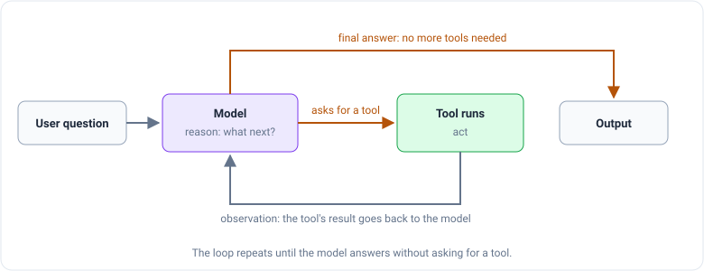

_Based on Pandas Studio's course "랭그래프(LangGraph) 활용 에이전트 RAG 구현" (Building agentic RAG with LangGraph).
This is part 1 of a series. The course is in Korean; I translated its prompts and outputs into English._

A chat model on its own can only use what it learned during training. It can't look up today's price of a bottle of
champagne, and it can't read a restaurant's menu. **Tool calling** is the mechanism that lets it reach outside itself:
the model asks for a function to be run, your program runs it, and the result goes back to the model.

It matters for more than chatbots. RAG, short for _retrieval-augmented generation_ (search first, then answer from what
you found), is built on the same idea, and every LangGraph agent later in this series sits on top of it. If the idea of
an AI "using a tool" is new, [this post](/engineering/agentic-ai-module-3-tool-use) explains it without code. Here we
look at how LangChain does it.

> **About the code and outputs.** The course was written for older versions of LangChain. The code in this post is
> updated to LangChain 1.x (`langchain` 1.4, `langchain-tavily` 0.2), so it's what you'd write today. Outputs come from
> two places, and each one is labeled: **My run** means I ran the code shown here (with `gpt-5.4-mini` and `gpt-5.5`);
> **Course output** means the course's own result from its older code, for steps I couldn't rerun.

## The idea in one picture

The classic small example: you ask "What is 2 times 3?" and give the model a `multiply(a, b)` function. The model
doesn't calculate anything. It writes back a filled-in request: the tool's name, `multiply`, and its arguments,
`{"a": 2, "b": 3}`. Your program runs `multiply(2, 3)` and gets 6.

That's the whole trick. The model's job is to choose the tool and fill in the form. Running it is your job.

## What a tool is made of

Every LangChain tool has four parts:

- **name:** what the tool is called.
- **description:** a sentence or two on what it does.
- **schema:** a description of the inputs it accepts (technically a JSON schema).
- **function:** the code that actually runs. It can also be an `async` function.

The model only ever sees the first three. It never sees the code inside. So the name, description and schema are the
order slip the model fills in, and it decides whether to use the tool based on that slip alone.

LangChain offers many ready-made tools: web search (DuckDuckGo, Tavily and others), code interpreters, productivity
apps and more. The course uses **Tavily**, a web search service built for AI apps, which needs an API key in the
environment variable `TAVILY_API_KEY`. Today it lives in its own package, `langchain-tavily`:

```python
from langchain_tavily import TavilySearch

web_search = TavilySearch(max_results=2)   # return at most 2 results

print(web_search.name)          # tavily_search
print(web_search.description)   # A search engine optimized for comprehensive, accurate, and trusted results. ...
print(list(web_search.args))    # ['query', 'include_domains', 'exclude_domains', 'search_depth',
                                #  'include_images', 'time_range', 'topic', 'start_date', 'end_date']
```

I printed these from the current package. The course's older version of this tool had a single input, `query`. The new
one has nine: the query plus eight optional filters (which websites to include or skip, how far back to search, and
so on). The model can fill those in too, if your question calls for it.

## Running a tool yourself vs. letting the model decide

The course compares two ways of using the same tool with the same question: "Please recommend a wine that goes with
steak."

**Running it directly.** You call the tool yourself and pass the question as the search query, word for word:

```python
query = "Please recommend a wine that goes with steak."
search_results = web_search.invoke({"query": query})
```

_Course output (older Tavily tool):_ two web pages, a Korean blog post on steak and wine (mentioning Cabernet
Sauvignon, Malbec, and a wine critic's favorite pairing with rare steak) and a steakhouse blog whose first
recommendation was Cabernet Sauvignon.

**Letting the model call it.** Now you hand the tool to the model with `bind_tools`, which attaches the tool's order slip
to every request, and send the model the question instead:

```python
from langchain.chat_models import init_chat_model

model = init_chat_model("openai:gpt-5.4-mini")
model_with_tools = model.bind_tools([web_search])
ai_msg = model_with_tools.invoke(query)
print(ai_msg.tool_calls)
```

`init_chat_model` is LangChain's provider-neutral way to load a model: change the string, and the same code runs on a
different provider. (The course used `ChatOpenAI(model="gpt-4o-mini")`, which still works.)

Here the course's run and mine went different ways, and the difference is the most useful lesson in this section.

_Course output (`gpt-4o-mini`, older tool named `tavily_search_results_json`):_ the model's text came back empty, and
it filled in **two** order slips instead of answering.

```text
[{'name': 'tavily_search_results_json', 'args': {'query': 'wine recommendations for steak'},
  'id': 'call_5lPOU0gWyOJXqVR5PZsY6uPa', 'type': 'tool_call'},
 {'name': 'tavily_search_results_json', 'args': {'query': 'steak and wine pairing tips'},
  'id': 'call_iC7y2CjvSR0vLxUoNLAIYFel', 'type': 'tool_call'}]
```

_My run (`gpt-5.4-mini`, current tool):_ no tool calls at all. The model just answered.

```text
tool_calls: []
text: A great classic pairing for steak is a Cabernet Sauvignon. ... Good alternatives: Malbec if you want something a
      bit softer and fruitier, Syrah/Shiraz for a peppery, more intense match, Merlot for a smoother, less tannic option.
```

I ran it three times and got the same choice each time: answer directly, no search. Both models are behaving
correctly. A tool is an _offer_, not an order. "What wine goes with steak?" is common knowledge, and the newer model
decided it didn't need to look it up. The older one decided to search, and wrote two shorter, sharper queries than your
original sentence. Nobody told it to split the question; it chose to.

So after any model call, the thing your code checks is: **is `tool_calls` empty?** Empty means "here's my answer."
Not empty means "run these first."

If your app needs a search every time (say, because prices change daily), you can take the choice away with
`tool_choice`:

```python
forced = model.bind_tools([web_search], tool_choice="any")   # must call a tool
ai_msg = forced.invoke(query)
```

_My run:_

```text
[{'name': 'tavily_search',
  'args': {'query': 'best wine pairing with steak red wine recommendations Cabernet Sauvignon steak pairing',
           'search_depth': 'basic', 'topic': 'general'}}]
```

One call this time, and notice the arguments: besides the query, the model filled in two of the optional inputs the
new Tavily tool offers, `search_depth` and `topic`. That's the schema at work: the model reads which inputs exist and
decides which to use.

## Three ways to run a tool call

Take the forced call from above: the model wrote a request, and now your code has to carry it out. The course shows
three ways, which differ in how much LangChain does for you:

```python
from langchain.messages import ToolMessage

tool_call = ai_msg.tool_calls[0]

# 1. Pass only the arguments: you get the raw search results back.
tool_output = web_search.invoke(tool_call["args"])

# 2. Pass the whole tool call: LangChain hands back a finished ToolMessage.
tool_message = web_search.invoke(tool_call)

# 3. Build the ToolMessage yourself from the raw results.
tool_message = ToolMessage(
    content=str(tool_output),
    tool_call_id=tool_call["id"],
    name=tool_call["name"],
)
```

A **`ToolMessage`** is the message type for a tool's result. Its key field is `tool_call_id`: it carries the same id
the model put on its request (`call_5lPOU0…` in the course's run). That's how the model matches each result to the
request it answers, which matters when the model asks for several searches at once, as the course's run did.

Option 2 is the one to remember: it copies the id over for you. The `ToolMessage`'s `content` is text, since that's
what gets sent to the model; with the current Tavily tool, it's the whole search response as a JSON string (the query,
an optional summary answer, and the list of results). A `ToolMessage` can also carry an **`artifact`**: extra data
that stays in your program and is never sent to the model. The course's older Tavily tool used it to keep each result's
relevance score and the search time (1.84 seconds in its run) out of the model's way.

## Handing the result back

Now put the steps together: ask the model, run whatever tools it asked for, then ask the model again with the results.
The model needs to see the whole conversation the second time, so we keep it in a list of messages:

```python
from datetime import date
from langchain.messages import HumanMessage, SystemMessage

def web_search_chain(question: str) -> str:
    messages = [
        SystemMessage(f"You are a helpful AI assistant. Today's date is {date.today()}."),
        HumanMessage(question),
    ]
    ai_msg = model_with_tools.invoke(messages)        # 1. model asks for searches
    messages.append(ai_msg)
    messages += web_search.batch(ai_msg.tool_calls)   # 2. run them all, get ToolMessages back
    return model_with_tools.invoke(messages).text     # 3. model answers from the results

web_search_chain("How much is Moët & Chandon today?")
```

Three details are doing real work. The system message tells the model today's date, so a question with "today" in it
means something. `batch` runs every tool call in the list and returns one `ToolMessage` per call. And `.text` pulls out
the reply's plain text.

The course writes this as a prompt template with an empty `placeholder` slot and a `@chain`-decorated function. Both
still work (I ran them on `langchain-core` 1.7), but a plain list of messages is all the job needs, and it's how the
current LangChain docs show it.

_Course output (older code):_

```text
Moët & Chandon currently costs about $51 to $65 on average for most bottles.
The exact price can vary by the store or region where you buy it.
```

Here is the full round trip, as four messages:


The model never runs anything. Steps 2 and 4 are model calls; step 3 is ordinary Python that you control.

## Writing your own tool

Ready-made tools only go so far. The usual way to make your own is the **`@tool`** decorator, which turns a normal
Python function into a LangChain tool. The course's example searches Naver, a Korean search engine, through its blog
search API. Here it is with two small fixes added, a timeout and HTML tag cleanup, both explained below:

```python
import re
import requests
from langchain.tools import tool

@tool
def blog_search(query: str) -> list[dict]:
    """Search Naver blog posts. Use this for people's reviews, opinions and personal experiences."""
    response = requests.get(
        "https://openapi.naver.com/v1/search/blog.json",
        headers={
            "X-Naver-Client-Id": NAVER_CLIENT_ID,
            "X-Naver-Client-Secret": NAVER_CLIENT_SECRET,
        },
        params={"query": query, "display": 10, "start": 1},
        timeout=10,
    )
    if response.status_code != 200:
        return []
    strip = lambda s: re.sub(r"</?b>", "", s)          # Naver wraps matched words in <b> tags
    return [
        {"title": strip(item["title"]), "link": item["link"],
         "description": strip(item["description"]), "postdate": item["postdate"]}
        for item in response.json()["items"]
    ]
```

LangChain reads the function to fill in the order slip. The function's name becomes the tool's **name**, the docstring
becomes its **description**, and the type hint `query: str` becomes the **schema**. Printed from the current package:

```text
name:        blog_search
description: Search Naver blog posts. Use this for people's reviews, opinions and personal experiences.
args:        {'query': {'title': 'Query', 'type': 'string'}}
```

That means the docstring isn't just a comment for other programmers. It's the only explanation the model gets, so write
it for the model: what the tool does and when to use it. The course's docstring only said what the tool does ("Sends a
search request to the Naver blog API"); the version above also says when to reach for it. The course's guidelines for
tool functions are to keep inputs and outputs clear, give each tool one job, and write the description so the model
understands exactly what the tool is for.

_Course output (its version, before the two fixes):_ blog posts like this one.

```text
[{'title': '<b>Steak</b> ... <b>goes well</b> ... recommendation', 'link': 'https://blog.naver.com/dolmory9/223556006280',
  'description': 'Red <b>wine</b> - Body : Medium-Full ~ Full - Sweetness : Dry - ...',
  'bloggername': 'Wine and coffee engineer', 'postdate': '20240821'}, ...]
```

Those `<b>` tags are why the new version strips them. Naver highlights the matched words in bold HTML, and the course's
tool passed them straight to the model. The `timeout` is the other fix: without one, a slow API would make the whole
program wait indefinitely.

## Steering tool choice with examples

With several tools available, the model has to pick the right one for each part of a question. Descriptions tell it
what each tool is for. **Few-shot prompting** goes further: you _show_ the model a few worked examples before the real
question, the way you'd show a new waiter a couple of finished orders before their first shift.

For tools, the example is a whole fake conversation written as messages. The course's example has three tools:
`search_menu` for the restaurant's own menu (the slides don't show how it's built), the web search, and `blog_search`
for what people say about a dish. A customer asks about the truffle risotto's price, features and reviews, and the
example assistant uses all three in turn:

```python
from langchain.messages import AIMessage, HumanMessage, SystemMessage, ToolMessage

@tool
def search_menu(query: str) -> str:
    """Search the restaurant's menu for dishes, prices and ingredients."""
    ...  # the slides don't show the course's version; any menu lookup goes here

examples = [
    HumanMessage("Tell me the truffle risotto's price and features, and what people think of it.",
                 name="example_user"),
    AIMessage("I'll search the menu, find more on the web, then look for people's reviews on blogs.",
              name="example_assistant"),
    AIMessage("", name="example_assistant",
              tool_calls=[{"name": "search_menu", "args": {"query": "truffle risotto"}, "id": "1"}]),
    ToolMessage("Truffle risotto: price ₩28,000, Italian Carnaroli rice, black truffle aroma and plenty of parmesan.",
                tool_call_id="1"),
    AIMessage("The truffle risotto is ₩28,000. Next I'll look for more about the dish on the web.",
              name="example_assistant"),
    AIMessage("", name="example_assistant",
              tool_calls=[{"name": "tavily_search", "args": {"query": "truffle risotto"}, "id": "2"}]),
    ToolMessage("Truffle risotto is a classic dish from northern Italy, known for its creamy texture "
                "and distinctive truffle aroma.", tool_call_id="2"),
    AIMessage("Now I'll look for people's reviews on blogs.", name="example_assistant"),
    AIMessage("", name="example_assistant",
              tool_calls=[{"name": "blog_search", "args": {"query": "truffle risotto review"}, "id": "3"}]),
    ToolMessage("Blog review of the truffle risotto: 'The fragrant truffle aroma and creamy texture are excellent.'",
                tool_call_id="3"),
    AIMessage("The truffle risotto (₩28,000) is a classic northern Italian dish made with Carnaroli rice, black truffle "
              "and parmesan. It's known for its creamy texture and truffle aroma, and bloggers praise exactly that.",
              name="example_assistant"),
]

system = SystemMessage(
    "You are an AI assistant providing restaurant menu information and general food knowledge. "
    "Search menu information with the search_menu tool, and general information with the tavily_search tool. "
    "For people's reviews or personal experiences, use the blog_search tool."
)

model_with_tools = init_chat_model("openai:gpt-5.5").bind_tools([web_search, blog_search, search_menu])

question = "Do you have a pasta dish?"
response = model_with_tools.invoke([system, *examples, HumanMessage(question)])
print(response.tool_calls)
```

The steps are: write the examples, put them between the system message and the real question, call the model, and read
the tool calls from its reply. Both the system message and the examples point the same way: menu questions go to the
menu, general facts to the web, opinions to blogs.

The slides don't show this chain's output, so I ran it with three questions. Only the model was called: these are
the tools it _asked for_, and none of them were executed.

_My run (`gpt-5.5`):_

| Question                                                            | Tools the model asked for                                                                  |
| ------------------------------------------------------------------- | ------------------------------------------------------------------------------------------ |
| "How much is the Signature Steak, and what do people say about it?" | `search_menu("Signature Steak price")`, `blog_search("Signature Steak restaurant review")` |
| "Where does tiramisu come from?"                                    | `tavily_search("origin of tiramisu where does tiramisu come from")`                        |
| "Do you have a pasta dish?"                                         | `search_menu("pasta dish")`                                                                |

All three routed the way the examples taught: the menu for what the restaurant serves, the blog for what people think,
the web for general knowledge. The first question had two halves, and the model split it across two tools in one reply.

Two notes against the course. It builds this with `ChatPromptTemplate.from_messages`, which still works; a plain list
does the same job. And one detail matters more than it looks: the tool names in the examples and the system message
must match the real tools. The course's prompt says `web_search` because that was its tool's name. With the current
Tavily tool, the name is `tavily_search`, so the examples above use that.

## From tool calls to an agent

Everything so far makes exactly one round of tool calls. But sometimes the model needs to see one result before it
knows what to ask for next. An **agent** handles that: it uses the model as a reasoning engine that decides which
action to take and what input to give it, takes the action, feeds the result back, and lets the model decide whether
to act again or finish.



The result of each action is called an **observation**. The loop ends when the model answers without asking for a tool.

Since LangChain 1.0, the one way to build this is **`create_agent`**: a model, its tools and a system prompt.

```python
from langchain.agents import create_agent

agent = create_agent(
    model,
    tools=[web_search, blog_search, search_menu],
    system_prompt=(
        "You are an AI assistant that provides restaurant menu information and food recommendations.\n"
        "Key guidelines:\n"
        "1. For menu information requests, always use the search_menu tool.\n"
        "2. If extra information related to the menu is needed (e.g. wine recommendations, cooking tips), "
        "use the tavily_search tool.\n"
        "..."
    ),
)

query = ("What's the price and character of the Signature Steak? "
         "And please recommend a wine that goes with steak.")
result = agent.invoke({"messages": [{"role": "user", "content": query}]})

for message in result["messages"]:
    message.pretty_print()
```

`create_agent` runs the loop for you: call the model, run the tools it picks, add the results to the conversation,
repeat until the model answers. What comes back is the whole conversation, so `pretty_print` shows every step: the
question, each tool call, each result, and the final answer. Under the hood it's a small LangGraph graph with two
nodes, `model` and `tools`, which is exactly what we'll build by hand in part 3.

The course built this with the older `create_tool_calling_agent` and `AgentExecutor`, which now live in the
`langchain-classic` package. That version needed a prompt with a special `agent_scratchpad` slot, where the agent's
intermediate steps were recorded. With `create_agent` there's no slot to wire up: the list of messages is the record.

_Course output (older `AgentExecutor` run):_ two actions, one per half of the question.

```text
Invoking: `search_menu` with `{'query': 'Signature Steak'}`
  → the Signature Steak's menu entry
Invoking: `web_search` with `{'query': 'wine recommendations for steak'}`
  → the steakhouse blog's wine recommendations
```

And the final answer, built from both:

```text
- Price: ₩35,000
- Main ingredients: premium Korean beef (hanwoo) sirloin, rosemary potatoes, grilled asparagus
- Features: the chef's signature dish, made with top-grade sirloin dry-aged for 21 days,
  cooked medium rare to keep it juicy ...

Wines that go with steak
1. Cabernet Sauvignon: its savory, deep flavor goes well with the steak's juices.
2. Syrah or Shiraz: a spicy aroma with rich berry fruit that suits steak.
```

The menu details match the Signature Steak's menu entry word for word, and the wine half came from the web search
step. Each half of the question went to the tool the system prompt pointed it to, and nobody wrote any glue code: the
agent ran the loop.

That "small LangGraph graph under the hood" is why this series goes there next. `create_agent` hands you a finished
loop. LangGraph lets you draw the loop yourself and decide what happens at each step.

## What to take away

- Tool calling is a request, not an action. The model fills in a tool's name and arguments; your code runs it and
  returns a **`ToolMessage`** with the same id.
- A tool is a **name, description, schema and function**, and the model sees only the first three. With `@tool`, they
  come from the function name, the docstring and the type hints, so write the docstring for the model.
- A tool is an offer. The model decides whether to call it (my run of the same question made no call) and writes its
  own queries when it does. Use `tool_choice="any"` when a call must happen.
- **Few-shot examples** show the model which tool fits which kind of question. Keep tool names in prompts matched to
  the real tools.
- An **agent** repeats the cycle (act, observe, decide) until it can answer. In LangChain 1.x, `create_agent` builds
  that loop on top of LangGraph.

Next, in part 2: LangGraph's `StateGraph`, where you lay out the steps and the decisions between them yourself.
