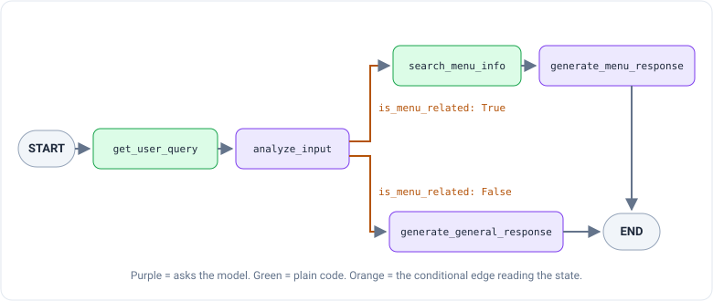
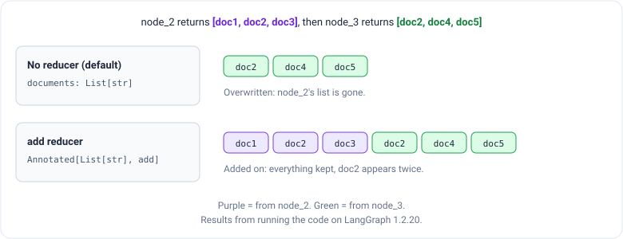
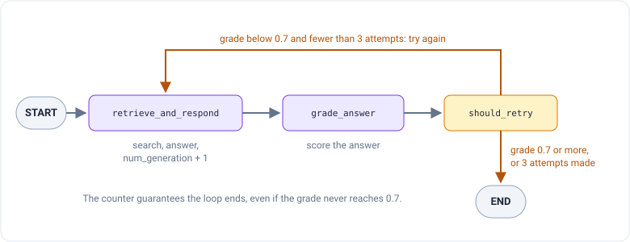

_Based on Pandas Studio's course "랭그래프(LangGraph) 활용 에이전트 RAG 구현" (Building agentic RAG with LangGraph).
This is part 2 of a series; [part 1](/engineering/langgraph-1-langchain-tool-calling) covered tool calling. As before,
I translated the course's Korean strings into English._

Part 1 ended with an agent whose loop was built for you by `create_agent`. You handed it a question and got an answer,
with no say over the steps in between. That's fine until you want a choice ("is this even a menu question?") or a
second attempt ("that answer was weak, try again").

**LangGraph** lets you write those steps out yourself, as a **graph**: named steps, with arrows between them saying
what runs next. Its main building block is the `StateGraph`, a graph that works by passing around a shared **state**.
The point is to model a complicated workflow as a set of states and the moves between them, so the system stays
flexible but you stay in control.

Think of a restaurant kitchen. Each station does one job, and an order ticket travels from station to station. Each
station reads the ticket, does its work, and writes its part on it.

> **About the code.** The code in this post is updated to current LangGraph (1.2) and LangChain (1.x), so it's what
> you'd write today. Most of the course's graph code needed no changes; where something did change, I say what. None of
> these examples need an API key, so I ran them, and every output shown is from my run on LangGraph 1.2.20.

## The three pieces

A `StateGraph` is built from three things:

- **State:** a shared data structure holding a snapshot of the app right now, the full context every step can see.
  It's usually written as a `TypedDict` (a Python dictionary with named, typed fields) or a Pydantic `BaseModel`.
  In the kitchen, it's the order ticket.
- **Node:** a Python function that holds one piece of the logic. It takes the current state as input, does some work
  (a calculation, a model call, a search), and returns an update to the state. In the kitchen, a station.
- **Edge:** the rule for which node runs next, based on the current state. It's either a fixed move ("always go to
  B after A") or a conditional branch ("go to B or C depending on the ticket"). In the kitchen, the route the ticket
  takes.

## The smallest graph

The course's first example has one state field, one node and two edges:

```python
from pydantic import BaseModel
from langgraph.graph import StateGraph, START, END

# The whole graph's state, shared by every node
class OverallState(BaseModel):
    text: str

# A node: read the state, return a change to it
def node(state: OverallState):
    return {"text": "Nice to meet you"}

# Build the graph and connect it with edges
builder = StateGraph(OverallState)
builder.add_node(node)                 # the node is named after the function: "node"
builder.add_edge(START, "node")        # the graph starts at node
builder.add_edge("node", END)          # after node, the graph ends
graph = builder.compile()

graph.invoke({"text": "Hello"})
```

`START` and `END` are special names for where the graph begins and where it stops. `add_node(node)` with no name uses
the function's name. `compile()` checks the wiring and turns the blueprint into something you can run. And `invoke`
runs it, starting from the ticket you hand in.

The state goes in as `"Hello"`, passes through the one node, and comes out as `"Nice to meet you"`. When I ran this
(with the course's original Korean strings), it returned `{'text': '반갑습니다'}`, the Korean for "nice to meet you."

Note what the node returns: not a whole new state, just `{"text": ...}`, the field it changed. LangGraph merges that
into the state. That detail is what reducers, further down, are about.

## Conditional edges: the graph makes a choice

A straight line of steps is just a script with extra ceremony. The point of a graph is that an edge can **branch**: a
**conditional edge** picks the next node at run time, based on the current state.

The course's example is a front desk for a restaurant. Some questions are about the menu and should be answered from
the menu. Others have nothing to do with the restaurant and should just get a normal answer. The graph has five nodes:

1. `get_user_query` takes in the question.
2. `analyze_input` decides whether it's about the menu, and writes `is_menu_related` (true or false) to the state.
3. `search_menu_info` searches the menu.
4. `generate_menu_response` answers from what the menu search found.
5. `generate_general_response` answers a non-menu question directly.

The branch after `analyze_input` is a small **routing function**. It reads the state and returns the name of the next
node:

```python
def decide_next_step(state: MenuState):
    if state["is_menu_related"]:
        return "search_menu_info"
    else:
        return "generate_general_response"

builder.add_conditional_edges(
    "analyze_input",
    decide_next_step,
    {
        "search_menu_info": "search_menu_info",
        "generate_general_response": "generate_general_response",
    },
)
```

`add_conditional_edges` says: after `analyze_input`, don't go to a fixed next step; call `decide_next_step` and go
wherever it points. The dictionary at the end maps each value the function can return to a node. Here the names happen
to match, so it looks redundant, but it means the routing function could return short labels like `"yes"` and `"no"`
instead.



The menu path has two steps, search then answer. The general path has one. Each path ends at `END`. The slides show
the wiring but not a run, so there's no output to show here.

## Reducers: how writing on the ticket works

So far, each node wrote to its own field. What happens when two nodes write to the **same** field?

That's decided by the field's **reducer**: a function that defines how a node's output gets merged into the graph's
state. There are three kinds:

- **Default:** the new value **overwrites** the old one. You get this when you don't specify anything.
- **`add`:** the new value is **added on** to the old one. Useful for lists that grow, like a list of chat messages.
- **Custom:** any function you write, for special handling such as removing duplicates or keeping a list sorted.

You attach a reducer to a field with `Annotated`, Python's way of hanging an extra note on a type. The course compares
the first two on a three-node graph where `node_2` and `node_3` both return lists for the same `documents` field:

```python
from operator import add
from typing import Annotated
from typing_extensions import TypedDict

class DocumentState(TypedDict):          # no reducer: overwrite
    query: str
    documents: list[str]

class ReducerState(TypedDict):           # add reducer: append
    query: str
    documents: Annotated[list[str], add]

def node_1(state):
    return {"query": state["query"]}                       # doesn't touch documents

def node_2(state):
    return {"documents": ["doc1.pdf", "doc2.pdf", "doc3.pdf"]}

def node_3(state):
    return {"documents": ["doc2.pdf", "doc4.pdf", "doc5.pdf"]}

# both graphs: START -> node_1 -> node_2 -> node_3 -> END
```

Same nodes, same outputs, two different endings:



- **No reducer:** the last write wins. `node_3`'s list replaced `node_2`'s, and `doc1` and `doc3` are gone. For a single
  value like a score, that's what you want. For a list that's meant to grow, it quietly loses data.
- **`add`:** the two lists are joined end to end. Nothing is lost, but `doc2` now appears twice. If duplicates matter,
  that's the job for a custom reducer.

One change from the course: its `node_1` returns `{"documents": None}`, and its slide shows the state as `None` after
that step in both versions. With no reducer that works, since `None` is simply overwritten. With the `add` reducer it
doesn't. When I ran the course's version, the graph stopped at `node_1` with
`TypeError: can only concatenate list (not "NoneType") to list`, because `add` tries to do `[] + None`. So the `node_1`
above leaves `documents` alone. The rule to remember: **with an `add` reducer, every node that writes the field must
return a list**, even an empty one, never `None`.

## A state for conversations: `MessagesState`

The course calls this section **MessageGraph**: a special kind of state graph for LangChain chat models, whose state
is a list of message objects (`HumanMessage`, `AIMessage` and the rest from part 1). Keeping the conversation in the
state lets the graph keep a natural flow and answer using what was said earlier.

The recipe has three steps: store the conversation in the state as a list of messages, put it under a key named
`messages`, and give that key a reducer so new messages are handled properly. There are two reducers to choose from:

- **`operator.add`** simply appends new messages to the list.
- **`add_messages`** appends too, but also tracks each message's id. If a node returns a message whose id is already
  in the list, it **updates** that message instead of adding a copy.

Written out by hand:

```python
from typing import Annotated
from typing_extensions import TypedDict
from langchain.messages import AnyMessage
from langgraph.graph.message import add_messages

class GraphState(TypedDict):
    messages: Annotated[list[AnyMessage], add_messages]
```

Because this is so common, LangGraph ships it prebuilt as **`MessagesState`**. You extend it with whatever else your
graph needs to track:

```python
from langgraph.graph import MessagesState
from langchain_core.documents import Document

class GraphState(MessagesState):
    # the messages key is already included
    documents: list[Document]
    grade: float
    num_generation: int
```

The course adds three cautions for message state:

- **Memory:** the list only grows. In long conversations, add logic to remove old messages.
- **Privacy:** messages can contain sensitive information, so handle them with care.
- **Performance:** if your message handling gets complicated, it may need optimizing.

> **What about `MessageGraph`?** LangGraph once had a separate `MessageGraph` class whose whole state was a single list
> of messages. It's deprecated since LangGraph 1.0 and will be removed in 2.0. The replacement is exactly what the
> course's code does: a normal `StateGraph` with a `messages` field using `add_messages`, which is what `MessagesState`
> gives you.

## A loop: grade the answer, try again

The last idea is an edge that points **backwards**. With conditional edges, a graph can repeat a step, which turns it
into a **feedback loop**: answer, check the answer, and if the check fails, answer again.

The course's example has two nodes. `retrieve_and_respond` searches, writes an answer, and adds 1 to the state's
`num_generation` counter. `grade_answer` scores that answer and stores the score in the `grade` field. Both fields are
in the `GraphState` above. Then a routing function decides whether to go around again:

```python
def should_retry(state: GraphState):
    if state.get("num_generation", 0) >= 3:    # already tried 3 times: stop
        return "generate"
    if state["grade"] < 0.7:
        return "retrieve_and_respond"          # weak answer: try again
    return "generate"                          # good enough: stop

builder.add_conditional_edges(
    "grade_answer",
    should_retry,
    {
        "retrieve_and_respond": "retrieve_and_respond",
        "generate": END,
    },
)
```

The label `"generate"` doesn't name a node at all. The mapping sends it straight to `END`. This is where the dictionary
in `add_conditional_edges` earns its keep: the routing function's return values don't have to be node names.



### Why the counter matters

The course's `should_retry` has only the grade check, not the first `if`. That version has no way to stop if the grade
never reaches 0.7: it would keep searching, answering and grading, paying for model calls on every lap.

LangGraph does have a safety net, the **recursion limit**: a run that takes more steps than that stops with a
`GraphRecursionError`. But in current LangGraph the default is about 10,000 steps, far too many model calls to rely on.

To see the difference without spending anything, I ran both versions with stand-in nodes: a `retrieve_and_respond`
that only counts, and a `grade_answer` that always returns 0.5, a grader that is never satisfied.

```text
With the counter:      answer attempt 1, 2, 3 → stops cleanly, num_generation = 3
Without the counter:   answer attempt 1, 2, 3, 4, 5 → GraphRecursionError
                       (run with config={"recursion_limit": 10})
```

The counter ends the loop on your terms. Without it, the run only stopped because I set a small recursion limit, and
it stopped with an error rather than an answer. So use both: a counter in the state as the real exit, and
`graph.invoke(inputs, config={"recursion_limit": ...})` as a backstop. The rule applies to every loop you build in
LangGraph: something has to guarantee it ends.

> **A newer option:** instead of a separate routing function, a node can pick the next step itself by returning
> `Command(update={...}, goto="retrieve_and_respond")` (from `langgraph.types`). Both styles are current. Conditional
> edges keep the decision visible in the wiring, which is why this series uses them.

## What to take away

- A LangGraph app is **state** (a shared dictionary or model), **nodes** (functions that read it and return updates)
  and **edges** (what runs next). A node returns only the fields it changed.
- **Conditional edges** let the graph branch: a routing function reads the state and names the next step. The mapping
  dictionary lets its labels differ from node names.
- **Reducers** decide what happens when nodes write to the same field. No reducer means the last write wins; `add`
  joins lists, so every write must be a list; custom reducers handle anything else.
- **`MessagesState`**, a `messages` field with the `add_messages` reducer, is the standard state for chat. The old
  `MessageGraph` class is deprecated.
- A graph can **loop** back to an earlier node. Every loop needs a way to end: a try counter in the state, with a
  recursion limit you set as a backstop.

Next, in part 3: a ReAct agent built as a graph, and a checkpointer that gives it memory between turns.
