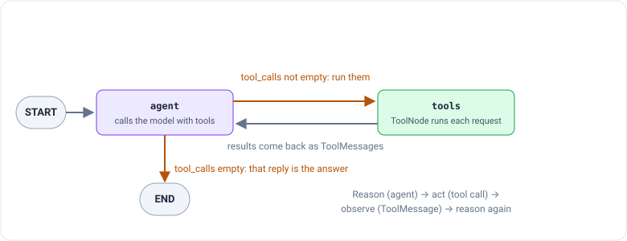

_Based on Pandas Studio's course "랭그래프(LangGraph) 활용 에이전트 RAG 구현" (Building agentic RAG with LangGraph).
This is part 3 of a series. [Part 1](/engineering/langgraph-1-langchain-tool-calling) covered tool calling and
[part 2](/engineering/langgraph-2-stategraph) covered graphs, state and loops. The course is in Korean; I translated
its prompts and outputs into English._

Part 1 ended with an agent that LangChain built for you. Part 2 showed how to draw a program as a graph, including a
loop. This post puts the two together: the same restaurant assistant, now as a LangGraph agent whose loop you can see
and change. Then it gives the agent a memory, so a follow-up like "which of the two is cheaper?" makes sense.

> **About the code and outputs.** The code is updated to current LangChain (1.4) and LangGraph (1.2). Outputs are
> labeled: **My run** means I ran the code shown (with `gpt-5.4-mini`); **Course output** is the course's own result.
>
> One thing to know about my runs: the course's `search_menu` tool searches the restaurant's full menu, which isn't
> published. So I used a stand-in that holds only the two menu entries the course's slides show, the Signature Steak
> and the Tenderloin Steak Salad, with a simple word match instead of a real search. It's enough for the steak questions
> below, and it's not the course's menu.

## ReAct: reason, act, observe

The most common kind of AI agent is called **ReAct**, short for _Reasoning + Acting_. The name comes from a 2022
research paper, "ReAct: Synergizing Reasoning and Acting in Language Models." The goal is for the model to do more
than write text: to interact with the world around it, using tools, to work through a task.

It works as a cycle:

1. **Act:** the model looks at the situation, picks a suitable tool, and calls it with the input it needs.
2. **Observe:** the tool's result, called the **observation**, goes back to the model, so it can see what its action
   did.
3. **Reason:** the model studies the observation and decides the next step: call another tool, or write the answer.

Then around again, until the task is done. The paper's own example is a trivia question about Apple's old remote control. The
model searches for the remote, learns from the result that it was made for a particular piece of software, searches for that
software, fails to find it by its short name, tries the full name, and finally reads that the software can also be
controlled with the keyboard's function keys. That's the answer. Each search was chosen because of what the previous
one returned. Breaking a hard question into steps like that, each informed by the last, is the whole point of the
cycle.

In LangChain terms, "act" is a tool call, "observe" is a `ToolMessage`, and the loop ends when the model replies with
an empty `tool_calls` list.

## The ready-made ReAct agent

The easiest way to get a ReAct agent is to have one built for you. The course uses LangGraph's `create_react_agent`.
Since LangGraph 1.0 that function is deprecated, and running it now prints a warning that it has moved to
`langchain.agents`. Its replacement is `create_agent`, which part 1 introduced:

```python
from langchain.agents import create_agent
from langchain.chat_models import init_chat_model
from langchain.messages import HumanMessage

model = init_chat_model("openai:gpt-5.4-mini")
tools = [search_menu, search_web]       # the menu search and the Tavily web search

system_prompt = ("You are a restaurant assistant. Use search_menu for questions about the restaurant's menu, "
                 "and tavily_search for anything else.")

agent = create_agent(model, tools=tools, system_prompt=system_prompt)

result = agent.invoke({"messages": [HumanMessage("How much are the steak dishes on the menu?")]})
for message in result["messages"]:
    message.pretty_print()
```

The course passed its system prompt as `state_modifier=`; in `create_agent` it's `system_prompt=`. (The slides don't
show the course's prompt text, so the one above is mine.) The steps are the same as in the course: import, set up the
model, define the tools, build the agent, run it.

`create_agent` returns a LangGraph graph with two nodes, `model` and `tools`, joined in a loop. Its reply is the whole
conversation, so `pretty_print` shows every step.

_Course output (`create_react_agent`):_

```text
Human:   How much is the steak?
AI:      tool call search_menu(query="steak")
Tool:    1. Signature Steak · Price: ₩35,000 · Main ingredients: premium Korean beef (hanwoo) sirloin,
         rosemary potatoes, grilled asparagus · Description: the chef's signature dish ...
AI:      The steak prices are: Signature Steak, ₩35,000 ...
```

_My run (`create_agent`):_

```text
Human:   How much are the steak dishes on the menu?
AI:      tool call search_menu(query="steak dishes and prices")
Tool:    1. Signature Steak · Price: ₩35,000 · ...   8. Tenderloin Steak Salad · Price: ₩26,000 · ...
AI:      The steak dishes on the menu are:
         - Signature Steak — ₩35,000
         - Tenderloin Steak Salad — ₩26,000
```

Same shape in both: one act (the menu search), one observation (the entries), one answer. The model needed only one
lap of the cycle, because one search held everything the question asked for.

## The same loop, built by hand

A ready-made agent is convenient, but you can't change what happens inside it. Building the same loop yourself takes
only two nodes:

- **`call_model`** sends the conversation to the model. The model either answers or asks for tools.
- **`execute_tools`** runs whatever tools the model asked for.

The second node is a **`ToolNode`**, a node LangGraph provides for exactly this job. It does four things:

1. Finds the tool requests in the `tool_calls` field of the most recent `AIMessage`.
2. Runs them, several at once if there are several (in parallel).
3. Wraps each result in a `ToolMessage`.
4. Adds those to the conversation, so the model sees them on its next turn.

That's the hand-written loop from part 1, packaged as a node.

The state is part 2's `MessagesState`, the conversation with the `add_messages` reducer, so every node's messages are
appended:

```python
from langchain.messages import SystemMessage
from langgraph.graph import StateGraph, MessagesState, START, END
from langgraph.prebuilt import ToolNode

model_with_tools = model.bind_tools(tools)

def call_model(state: MessagesState):
    messages = [SystemMessage(system_prompt)] + state["messages"]
    return {"messages": [model_with_tools.invoke(messages)]}

def should_continue(state: MessagesState):
    last_message = state["messages"][-1]
    if last_message.tool_calls:          # the model asked for tools: go run them
        return "execute_tools"
    return END                           # no tools requested: this reply is the answer

builder = StateGraph(MessagesState)
builder.add_node("call_model", call_model)
builder.add_node("execute_tools", ToolNode(tools))

builder.add_edge(START, "call_model")
builder.add_conditional_edges("call_model", should_continue)
builder.add_edge("execute_tools", "call_model")     # after tools, always back to the model

graph = builder.compile()
```

The whole ReAct cycle is in those last few lines. The conditional edge is the "reason" decision: do I need to look
something up? `execute_tools` is "act". And the plain edge from `execute_tools` back to `call_model` is "observe": read
what came back, and decide again. Writing `should_continue` yourself is what gives you fine control over the agent:
it's the one place that decides whether the run keeps going.

`add_conditional_edges` has no mapping dictionary here, unlike in part 2. It doesn't need one: `should_continue`
returns either a real node name or `END`, so LangGraph can follow its answer directly.

_My run:_ asked the same steak question, it made the same single `search_menu` call, got the same two entries, and
gave the same two prices. That's expected: this graph does exactly what `create_agent`'s graph does. The difference is
that now you can see and edit every part of it.

## The same loop, shorter: `tools_condition`

`should_continue` is so common that LangGraph ships it ready-made as **`tools_condition`**. It looks at the latest
message: if it contains tool calls, it routes to the node named `"tools"`; if not, it routes to `END`.

```python
from langgraph.prebuilt import tools_condition

builder = StateGraph(MessagesState)
builder.add_node("agent", call_model)
builder.add_node("tools", ToolNode(tools))

builder.add_edge(START, "agent")
builder.add_conditional_edges("agent", tools_condition)
builder.add_edge("tools", "agent")

graph = builder.compile()
```

One catch: `tools_condition` always sends tool calls to a node called **`"tools"`**. That's why the nodes are renamed
here, `agent` and `tools`, instead of `call_model` and `execute_tools`. If you keep the old name, it routes to a node
that doesn't exist.



_My run:_ again the same single search and the same two prices. Three ways to build one loop, and all three behaved
identically.

## Memory: what does "the two" mean?

Now a follow-up question. After asking about the steak prices, a customer naturally asks: "Which of the two is
cheaper?"

_My run (the `tools_condition` graph, new `invoke`):_

```text
Human:   Which of the two is cheaper?
AI:      tool call search_menu(query="two cheapest items comparison")
         tool call search_menu(query="two items")
Tool:    No matching menu information found.   (both)
AI:      I'm not sure which two items you mean. Please tell me the names of the two dishes/drinks,
         and I'll compare their prices for you.
```

The model had no idea what "the two" were. It even searched the menu for "two items", which found nothing, then asked.
That's not the model being slow. It's how graphs work by default: **every `invoke` starts from a fresh state.** The
steak conversation lived in the previous call's state, and that state was thrown away when the call ended. The graph
is _stateless_ between calls.

That's a problem for any real conversation. You want three things: continuity across turns, the ability to pick a
conversation back up after a break, and separate conversations kept apart.

### Checkpointers

LangGraph's answer is a **checkpointer**: something that saves the graph's state after every step, so the next call can
continue from where the last one stopped. The course uses `MemorySaver`, which does three jobs:

1. **Checkpointing:** saves the state after each step of the graph.
2. **Storage:** keeps those saved states in an in-memory key-value store, so they can be looked up.
3. **Persistence:** lets a run resume from a saved checkpoint.

`MemorySaver` is now called **`InMemorySaver`**; the old name still works and points to the same class. You attach it
when compiling:

```python
from langgraph.checkpoint.memory import InMemorySaver

memory = InMemorySaver()
graph_memory = builder.compile(checkpointer=memory)
```

Saved conversations are filed under a **`thread_id`**, a name you choose for each conversation. The checkpointer
records every step under that id, and any later call with the same id picks up that thread:

```python
config = {"configurable": {"thread_id": "1"}}

graph_memory.invoke({"messages": [HumanMessage("How much are the steak dishes on the menu?")]}, config)
graph_memory.invoke({"messages": [HumanMessage("Which of the two is cheaper?")]}, config)
```

The second call sends only the new question. The checkpointer loads thread "1"'s saved messages, the `add_messages`
reducer from part 2 appends the new question, and the model sees the whole conversation. The slides show this code but
not its output, so here's mine.

_My run (thread "1", second turn):_

```text
Human:   How much are the steak dishes on the menu?
AI:      tool call search_menu(query="steak dishes and prices")
Tool:    1. Signature Steak · ₩35,000 ...   8. Tenderloin Steak Salad · ₩26,000 ...
AI:      The steak dishes on the menu are: Signature Steak — ₩35,000, Tenderloin Steak Salad — ₩26,000
Human:   Which of the two is cheaper?
AI:      The cheaper one is the Tenderloin Steak Salad at ₩26,000.
```

Correct, and notice what's missing: no second search. The prices were already in the conversation from the first
turn, so the model answered straight away and the graph went to `END`. The returned state held all six messages from
both turns, which shows the history really was loaded.

Then I asked the same follow-up on a **different** thread, `"thread_id": "2"`. Nothing had been said there yet, so the
model was lost again: it ran a couple of vague menu searches, then replied that it couldn't tell which of the two was
cheaper without the item names. Threads keep conversations apart, which is how one app can talk
to many customers at once without mixing them up: each conversation gets its own `thread_id`.


Two cautions about this kind of memory:

- **`InMemorySaver` lives in RAM.** Restart the program and every conversation is gone. For real apps, LangGraph has
  checkpointers that save to a database instead. The interface is the same; only the storage changes.
- **The history only grows.** Every turn adds messages, and every model call sends all of them, which part 2's
  cautions about message state already warned about. Long conversations get slower and more expensive, so trimming or
  summarizing old messages is the usual fix.

## What to take away

- A **ReAct agent** is a cycle: **act** (call a tool), **observe** (read the result), **reason** (decide what's next),
  repeated until the model answers without asking for a tool.
- `create_agent` builds that loop for you. It replaces LangGraph's older `create_react_agent`, and its
  `system_prompt=` replaces `state_modifier=`.
- By hand, the loop is two nodes, a model node and a **`ToolNode`**, plus one conditional edge and one edge back.
  `tools_condition` is the prebuilt version of that edge, and it expects the tool node to be named `"tools"`.
- Without a **checkpointer**, every call starts from scratch. With `InMemorySaver` and a **`thread_id`**, each
  conversation keeps its history, and follow-ups like "which of the two?" just work.

Next, in part 4: graphs that decide where to search before they search, and that pause for a person to check their
work.
