_Based on DeepLearning.AI's
[Preprocessing Unstructured Data for LLM Applications](https://www.deeplearning.ai/short-courses/preprocessing-unstructured-data-for-llm-applications/),
which uses the open-source [Unstructured](https://github.com/Unstructured-IO/unstructured) library._

Imagine you're building a chatbot that answers questions about your school or company. The answers live in emails,
PDFs, slide decks and web pages. The AI doesn't know any of it on its own, so your app has to find the right bits of
those documents and paste them into the question before the AI sees it. That trick is called **retrieval-augmented
generation**, or **RAG**.

There's a catch: those documents are a mess. A PDF, a slide deck and a web page all store text in completely different
ways. A form looks nothing like a research paper. Before any searching can happen, you have to clean all of it up. That
cleanup is called **preprocessing**, and this post walks through it step by step:

1. **Normalize:** turn every file into the same kind of labeled pieces.
2. **Read PDFs and images:** teach the computer to work out a page's structure by looking at it.
3. **Handle tables:** keep rows and columns intact.
4. **Save your work** so you only do the expensive part once.
5. **Add metadata:** attach labels like page numbers, dates and chapters.
6. **Chunk:** group the pieces into sensible bundles the AI can search.

## Step 1: Normalize everything into the same building blocks

### Every format speaks a different language

Every document has the same basic parts. There are **titles**, regular paragraphs (the course calls these **narrative
text**), **list items**, **tables**, and **headers and footers** like page numbers. But each file type marks those parts
in its own way:

- **Web pages (HTML)** wrap text in tags. A heading tag usually means "this is a title," and a paragraph tag usually means
  "this is normal text." The words help too: a long passage with several sentences is probably a paragraph, while a short
  line in ALL CAPS is probably a title, even if it sits inside a paragraph tag.
- **PowerPoint files** are, under the hood, a bundle of structured text describing each slide. A rule-based program can
  read which box is the slide title and which lines are bullet points. (Old `.ppt` files can be converted to the newer
  `.pptx` format first.)
- **PDFs and scanned images** have no labels at all. They only know where the ink goes on the page. That's a harder
  problem, so it gets its own step below.

### The fix: translate everything into one list

**Normalizing** means breaking every document into the same set of labeled building blocks, no matter where it came
from. It's like taking notes from three textbooks written in three different languages, and writing all your notes in
one language.

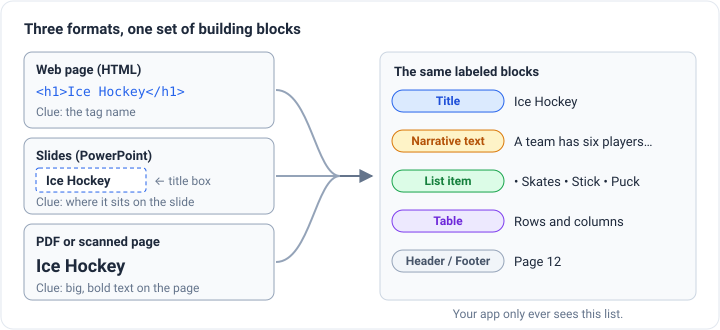

Once everything is in that one list, your app doesn't care whether something started as a PDF or a web page. That pays
off in three ways:

- **One cleanup rule for every format.** Want to throw away page numbers and footers? That's one rule over the list,
  instead of separate code for PDFs, slides and web pages.
- **One chunking method for every format.** You don't need a different way to cut up each file type.
- **Cheap experiments.** More on this in Step 4.

## Step 2: Teach the computer to read a page

A web page literally says "this is a title." A PDF doesn't. To a computer, a PDF is mostly instructions for where to put
ink, and a scan is just a photo. So the computer has to do what you do without thinking: look at the page and work out
what each part is from how it looks. Big bold text near the top? Probably a title. A long block of plain text? Probably
a paragraph. A grid of numbers? A table.

This is called **document image analysis**, and there are two main ways to do it.

### Method 1: Layout detection

**Layout detection** works in two steps, a bit like a student going through a printed page with highlighters.

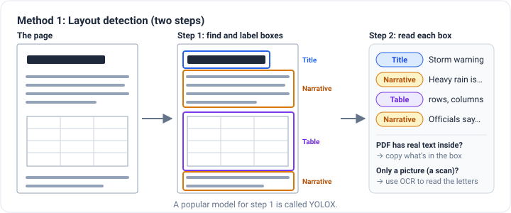

**Step 1: Draw and label boxes.** An AI model trained to spot objects in pictures looks at the page, draws a box around
each part, and labels it: title, paragraph, list, table. (A popular model for this is called **YOLOX**. It's the same
family of models used to spot cars or people in photos, trained on documents instead.)

**Step 2: Read the text inside each box.** There are two ways to do this, depending on the file:

- **If the PDF has real text inside it,** like most PDFs saved from a word processor, the program just copies the text
  that falls inside each box.
- **If the page is only a picture,** like a scan or a phone photo, there's no text to copy. The program has to use
  **OCR** (optical character recognition), which turns a picture of letters into actual letters you can search.

### Method 2: Vision transformers

A **vision transformer** does the whole job in one go. You give it a picture of the page, and it writes out the labeled
blocks directly, like a person reading the page and typing up neat notes. It can be trained to write those notes in
**JSON**, a simple text format for organized data.

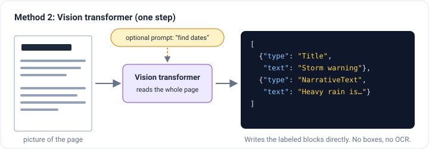

There's no box drawing and no separate OCR step. And because it works like the AI chatbots you already know, you can
give it a **prompt** to steer what it pulls out. One well-known design is called **Donut** (short for "document
understanding transformer").

### Which one should you use?

|               | Layout detection                                                                                 | Vision transformer                                                                                         |
| ------------- | ------------------------------------------------------------------------------------------------ | ---------------------------------------------------------------------------------------------------------- |
| **Good at**   | Very reliable on the standard block types it was trained on                                      | Unusual documents like forms, and new kinds of blocks                                                      |
| **Bonus**     | Boxes let you trace every result back to its spot on the page                                    | You can add a new block type just by changing the prompt                                                   |
| **Downsides** | Can take two model runs (boxes, then OCR), and it's stuck with the block types it was trained on | Can make things up or repeat itself like any chatbot, and it needs a lot of computing power or runs slowly |

A good rule of thumb: layout detection is the steady, predictable choice for everyday documents. Vision transformers
are more flexible but riskier and pricier.

There's also a shortcut for easy cases. If a PDF is simple, like a plain news article with real text inside, a **fast**
mode can skip the AI models and pull the text out directly. Save the expensive models for PDFs that actually need them.

### Does it work? One article, two formats

To test this, the course processes the same news article (a story about El Niño storms hitting California) twice: once
as a web page, using the tags, and once as a PDF, using layout detection.

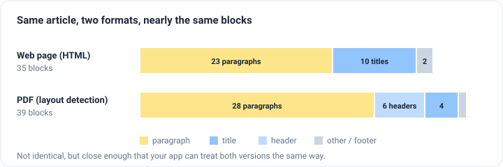

The results aren't identical. The PDF version found a few more paragraphs and labeled some title-like lines as headers.
But they're close, and that's the whole point of normalizing: whether the article arrived as a web page or a PDF, your
app gets almost the same list of blocks.

## Step 3: Handle tables with care

Tables pack a lot of information into a small space, like sales numbers, test results or sports standings. They're also
where document reading goes wrong most often.

### Why tables are tricky

A table's meaning lives in its **rows and columns**. "12" means nothing alone. It means "the Eagles won 12 games" only
because of where it sits. Read a table as plain text, left to right, and that structure disappears.

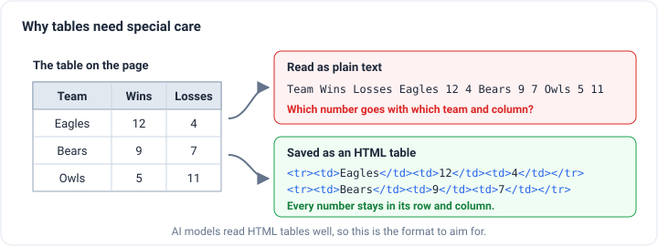

The course shows this with a real table from a science paper about slowing down corrosion (rust). Read as plain text, it
came out as one long string of labels and numbers, with no way to tell which value belonged in which column.

The fix is to save tables as **HTML**, the same format web pages use for tables. HTML keeps every cell in its row and
column, and AI models are good at reading it.

### Three ways to read a table

Web pages and Word documents already mark their tables, so simple rules can read them. PDFs and images need the visual
approach: first find the table on the page with layout detection, then work out its structure. There are three ways to
do that second part:

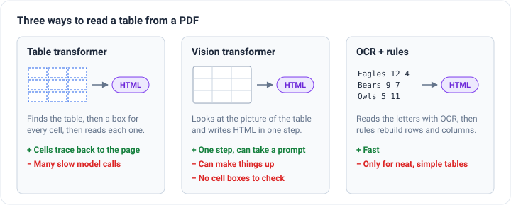

1. **Table transformer.** A model finds a box for every single cell, reads each one, and builds an HTML table. Every cell
   can be traced back to its spot on the page, which is great for checking. The cost is lots of model runs, so it's slow.
2. **Vision transformer.** The same one-step reader from Step 2, but this time it writes an HTML table instead of JSON.
   It's flexible and takes prompts, but it can make up numbers, and there are no cell boxes to check its work against.
3. **OCR + rules.** Read the letters with OCR, then use simple rules to rebuild rows and columns. It's fast, but it only
   works well on neat, simple tables.

The course uses the table transformer, and suggests trying a vision transformer model called **Chipper** on the same
document to compare the two.

### Make tables easy to find

A grid of numbers doesn't "mean" much on its own, which makes it hard for a search to match a question to it. (Step 5
explains how that search works.) The trick is to have an AI write a short **summary** of each table and search the
summary instead. When a summary matches the question, hand the AI the **full table** to answer from.

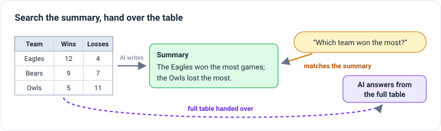

### Check the details

When I ran the corrosion table through the lesson, the HTML version kept all six rows and seven columns lined up. That's
a big step up from the plain text. But looking closer turned up three problems:

- **Symbols got misread.** The unit "A/cm²" came out as "A/cm?", and the ohm symbol "Ω" came out as the letter "Q".
- **A decimal point went missing.** One resistance value came out as 42121, while the values around it are in the low
  hundreds.
- **The AI summary was half wrong.** It said that as more inhibitor (the anti-rust chemical) is added, both the
  corrosion rate and the "polarization resistance" go down. The corrosion rate does drop, from about 2.8 to 0.09 mm per
  year. But the resistance actually _rises_, from about 24 with no inhibitor to a few hundred with it.

None of these look wrong at a glance, and that's what makes them dangerous. The structure is right, so the table looks
trustworthy, but a few of the facts inside it aren't. Use summaries to _find_ tables, always hand the AI the real table
to answer from, and spot-check numbers that matter.

## Step 4: Save your work

Pulling the content out of the files (called **extraction**) is the slow, expensive part, especially for PDFs and tables,
which need AI models. Everything after it is cheap. So you extract once and **save the result to a file**, like saving
your notes so you never have to reread the whole textbook.

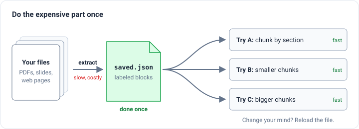

The course saves the results as JSON. It's a good pick because:

- Almost every programmer already knows it.
- It's what web services usually send back, so results from an online PDF-reading service come back in the same shape
  as the results you make yourself.
- Nearly every programming language can read it. You can process documents in Python and use the results in a
  JavaScript app.
- It works for streaming, too: a variation called JSON Lines stores one item per line, so you can handle items as they
  arrive.

## Step 5: Add metadata, the labels that make search smarter

### What metadata is

**Metadata** is information _about_ a piece of text, not the text itself. Think of the label on a library book's spine:
it isn't the story, but it tells you the shelf, the author and the subject.

Some labels come straight from the file, like the file name, the page number or when it was last edited. Others get
worked out during processing, like what type of block it is (title or paragraph?) or which section title it falls
under.

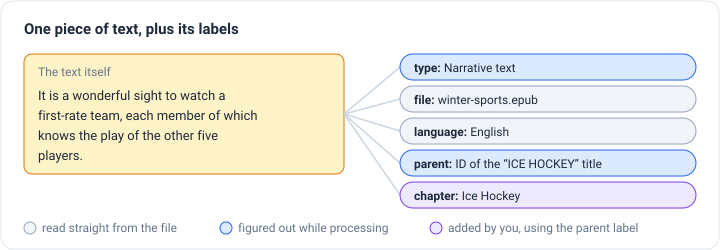

### Searching by meaning, and where it falls short

Most RAG apps find text with **semantic search**, which means searching by meaning. Each piece of text gets turned into
coordinates on a "map of meaning," so similar ideas sit close together. Dog and cat land near each other, and both land
far from tomato. When a question comes in, the app grabs the pieces closest to it on the map. These pieces are stored in
a special kind of database called a **vector database**.

That works well most of the time, but meaning alone has blind spots:

- **Too many matches.** If a whole document is about one topic, lots of pieces will look equally relevant.
- **No sense of time.** You might want the most _recent_ information, not just the most similar.
- **Lost structure.** It can't tell which section or chapter a piece came from, even though that often matters.

### Hybrid search: meaning plus filters

**Hybrid search** combines searching by meaning with **filters** on the metadata. Picture two news articles: one from
the day before the Super Bowl about who's favored to win, and one from the day after with the final score. Ask "What's
the latest Super Bowl news?" and both look relevant, because both are about the Super Bowl. Add a date filter and only
the real result comes back.

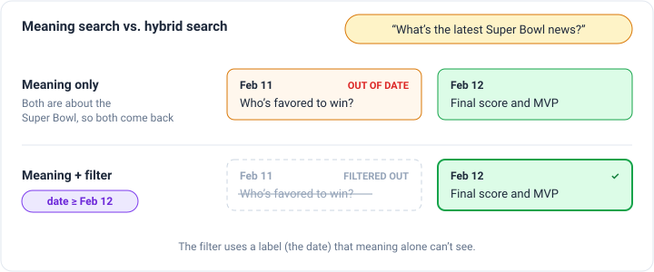

### Example: searching inside one chapter

The course tries this on an old book, _Winter Sports in Switzerland_, which has chapters on skating, curling, ice hockey,
skiing and more. The goal is to ask a question about one chapter only.

1. **Find the chapter titles.** The table of contents lists the chapter names. After normalizing, each of those titles
   is its own block with a unique ID.
2. **Follow the parent labels.** Each block gets a metadata label called a **parent ID**, which points to the title of
   the section it sits under. So every paragraph in the hockey chapter points back to the "ICE HOCKEY" title.
3. **Tag every piece with its chapter.** Using those parent IDs, each piece gets a simple `chapter` label like
   "Ice Hockey."
4. **Store and search.** All the pieces go into a vector database with their chapter labels. Then you ask, "How many
   players are on a team?" and filter to the Ice Hockey chapter only.

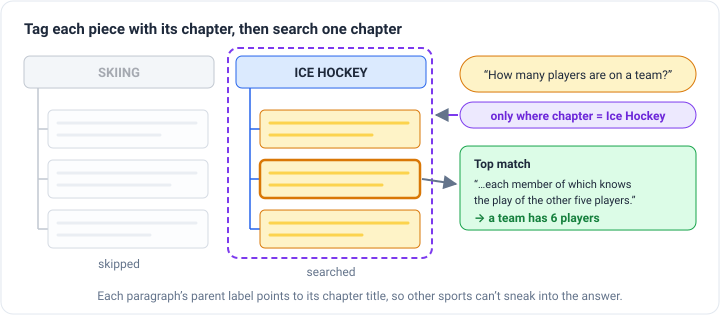

The top result is a passage about how each player on a good team knows the play of the other five. That means a team
has six players. Without the filter, paragraphs about curling, another team sport in the book, could have crowded in.

## Step 6: Chunk using the building blocks

### Why chunk at all?

**Chunking** means grouping text into pieces small enough to search and hand to the AI. There are two main reasons:

1. **AI models have a reading limit,** so you often can't pass in a whole document.
2. **Longer inputs cost more money.** Smaller, focused chunks keep each question cheap.

How you cut also changes what search finds. Better chunks mean better search results, which mean better answers. (For a
deeper dive on chunking methods, see [How to Cut Up a Book So an AI Can Read It](/engineering/five-levels-of-text-splitting).)

### Cutting by size vs. building from blocks

The simplest way to chunk is to cut every so many characters (or words), no matter what the text says. The problem is
that sections bleed into each other. A chunk can end up half about one topic and half about the next, so a search pulls
in text you didn't want.

Because the document is already split into labeled blocks, you can do something smarter. Instead of cutting one big
document down, you **build chunks up** from the blocks, and you start a new chunk whenever you hit a **title**. Titles
usually mark the start of a new section, so each chunk stays about one thing.

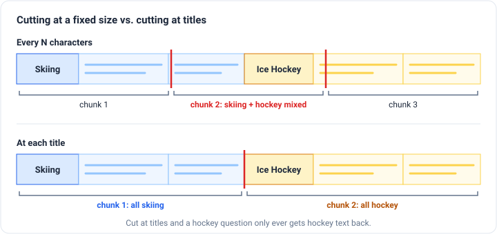

The course's version also has two safety settings:

- **Merge tiny pieces.** Blocks under 100 characters get combined with their neighbors, so you don't end up with chunks
  that are just a few words long.
- **Cap the size.** If a section runs past 3,000 characters, it gets split, so no chunk gets too big.

On the winter sports book, this turned 718 small blocks into 198 chunks: fewer, bigger, and each one about a single
section.

And because chunking runs on the saved list of blocks from Step 4, you can change these settings and try again in
seconds, without paying to extract the documents again.

## Putting it all together

Here's the whole pipeline, from a messy pile of files to something an AI can use:

1. **Pull out the content.** Web pages and slides label themselves. PDFs and images need layout detection or a vision
   transformer, and the simplest PDFs can use the fast mode.
2. **Normalize** everything into the same labeled building blocks.
3. **Handle tables carefully.** Keep them as HTML so rows and columns survive, add summaries so they can be found, and
   spot-check the numbers.
4. **Save** the results, so you only pay for extraction once.
5. **Add metadata** like page numbers, dates and chapters, so search can filter.
6. **Chunk by section,** then store everything in a vector database and search with meaning _plus_ filters.

None of this is flashy, but it decides how good your AI's answers can be. An AI can only answer as well as the text it's
handed, and handing it the right text starts with clean, well-labeled documents.
