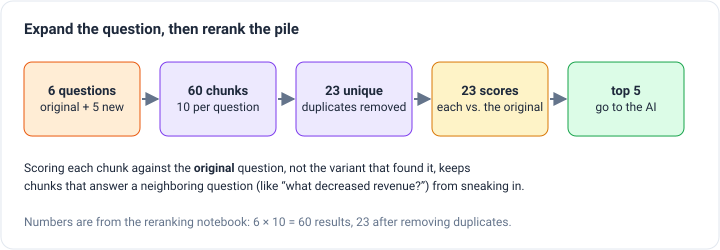
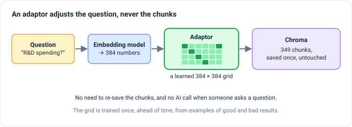
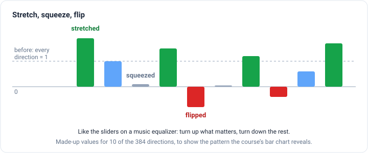
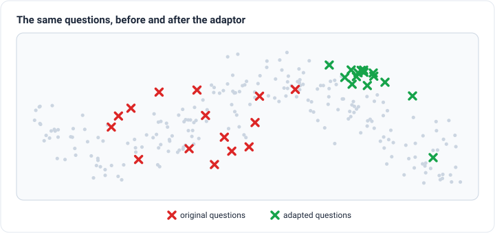

_Based on lessons 4 to 6 of DeepLearning.AI's
[Advanced Retrieval for AI with Chroma](https://www.deeplearning.ai/short-courses/advanced-retrieval-for-ai/) and
their notebooks._

[Part 1](/engineering/query-side-retrieval) showed how a vector database like Chroma finds chunks: it turns your
question into 384 numbers and returns the chunks with the closest numbers. That works most of the time, but it also
brings back **distractors**, chunks that are close in meaning but don't answer the question. Part 1 ended with a new
problem: rewriting one question into several gives you a pile of results, and you need a way to sort them.

This part covers the rest of the course:

- **Reranking**, which sorts results by how well each one actually answers the question.
- **Embedding adaptors**, which learn to nudge a question's numbers so it lands in a better spot.
- **Other techniques** researchers are working on now.

Every example still searches the same document: Microsoft's 2022 annual report, cut into 349 chunks.

## Fix 2: Rerank the results

### Skim vs. interview

The search in part 1 is fast because the question and each chunk get their numbers _separately_. Every chunk's numbers
are worked out once, ahead of time, and a new question is just compared against them. The technical name is a
**bi-encoder**. It's like skimming a pile of résumés: quick enough to look at all 349 chunks, but the question and the
chunk are never actually read side by side.

A **reranker** does the careful version. It's a model that takes the question and one chunk _together_ and gives back a
score for how well that chunk answers that question. The technical name is a **cross-encoder**. It's like a job
interview: much sharper, and much too slow to give to everyone. So you only interview the shortlist that search already
found.

The course uses a small reranker called `ms-marco-MiniLM-L-6-v2`. The instructor points out that it's lightweight and
runs entirely on your own computer, with no AI service to call.

### Digging into the long tail

Remember the research and development question from part 1? Its top 5 results had 3 useful chunks and 2 distractors. So
this time the lesson asks Chroma for **10** results instead of 5. The first 5 come back exactly the same, since search
always gives the same answer for the same question. The extra 5 are the **long tail**: results that ranked lower but
might still be useful.

Then the reranker scores all 10. Here's what my run of the notebook produced:

A few things changed:

- **The top two swapped.** Search put the R&D spending table first, but the reranker preferred the chunk about Microsoft's
  plans to keep investing in R&D and Microsoft Research, with a score of 2.64 against 0.99.
- **The two distractors dropped out.** The digital skills chunk fell from 4th to 9th, and the partner program chunk from
  5th to 8th.
- **Two long-tail chunks moved in.** The chunk explaining how R&D costs are counted rose from 7th to 4th, and a chunk
  about licensing that mentions ongoing research rose from 6th to 5th.

It isn't perfect. That 5th chunk is mostly about licensing, and it only mentions research in passing. But it beat both
distractors, and if you keep just the top 5, you now hand the AI four solid chunks instead of three.

What about the scores themselves? They aren't percentages. Here they run from 2.64 down to −10.93, and the useful thing
is the order, not any single number. Higher means "answers this question better."

### Sorting the pile from query expansion

Now go back to the problem from the end of part 1. Query expansion turns one question into several, and each one brings
back its own results. The lesson takes the revenue question and five AI-written variations of it:

- What were the most important factors that contributed to increases in revenue? _(the original)_
- What were the major drivers of revenue growth?
- Were there any new product launches that contributed to the increase in revenue?
- Did any changes in pricing or promotions impact the revenue growth?
- What were the key market trends that facilitated the increase in revenue?
- Did any acquisitions or partnerships contribute to the revenue growth?

Each of the 6 questions gets 10 results, 60 in total. Many overlap, so after removing duplicates there are 23 unique
chunks. Then the reranker scores each of the 23 against the **original** question, and only the top 5 go to the AI.

Scoring against the original matters. A chunk found by "did any acquisitions contribute?" should only survive if it
helps answer what was actually asked. The variations widen the net, and the original question decides what stays.

One thing I noticed in my run: all 23 scores were below zero, and the best was −1.14. Because only the order is
meaningful, that doesn't prove nothing was useful. It does hint that no single chunk answers "what were the most
important factors?" neatly, which is common for broad questions. (The notebook prints scores and a new order, but not
which chunks won, so I can't tell you what they said.)

The instructor makes one more point worth keeping. The same results can get very different scores for slightly different
questions, because the reranker pays attention to different parts of the question than the search does. Try a few
wordings and watch the order change.

For how a reranker's scores let a system say "I don't know" when nothing is good enough, see the
[advanced retrieval post](/engineering/advanced-retrieval-pipeline).

## Fix 3: Adjust the question's numbers (embedding adaptors)

Reranking cleans up after the search. An **embedding adaptor** tries to make the search land in the right place in the
first place.

The idea is to add one small step between the embedding model and Chroma. The embedding model turns the question into
its 384 numbers as usual, and then the adaptor adjusts those numbers before the search runs. The chunks stay exactly
as they were saved.

Think of it like prescription glasses for the search. The embedding model sees the world in a general way. The adaptor
is a lens fitted to _your_ documents and _your_ users' questions.

_A note on sources: this lesson's notebook didn't run for me, because the AI model it calls (`gpt-3.5-turbo`) has been
retired. So the numbers in this section come from the lesson video, and the examples and pictures are my own
illustrations of what it shows._

### Training data: thumbs up and thumbs down

To fit the lens, you need examples of good and bad results. In a real app, the best source is your users: if they give
an answer a thumbs up or thumbs down, you can trace that back to the chunks that were retrieved.

The course has no users yet, so it fakes them in two steps:

1. An AI writes 10 to 15 short questions an analyst might ask about an annual report.
2. For each question, Chroma retrieves 10 chunks, and an AI judge answers yes or no: is this chunk relevant?

That gives 150 examples, 15 questions times 10 chunks. Each "yes" becomes **+1** and each "no" becomes **−1**.

Why +1 and −1 instead of 1 and 0? The search compares directions. Two lists of numbers that point the same way score 1,
and two that point in opposite directions score −1. So the labels are targets: relevant chunks should point the same
way as the question, and irrelevant chunks the opposite way.

### What gets trained

The adaptor is a single grid of 384 × 384 numbers, about 147,000 in total. The question's 384 numbers are multiplied
by the grid to make new ones. Training nudges the grid, over and over, so that adjusted questions point toward their
+1 chunks and away from their −1 chunks.

It's tiny by AI standards, so training takes seconds. The video runs 100 rounds through the 150 examples and reports a
best error ("loss") of about 0.5, which the instructor describes as roughly halfway better than where it started.

### Stretch, squeeze, flip

To see what the grid learned, the course feeds it a test question where every one of the 384 directions is set to 1,
and plots what comes out. Some directions get **stretched** (they matter for these questions), some get **squeezed**
toward zero (they don't), and some get **flipped** below zero (they point away from what users want).

It's like the sliders on a music equalizer. The song is the same, but you turn up the parts you care about and turn down
the rest.

### Where the questions move

The last plot in the lesson shows the 15 generated questions on the flattened map from part 1, before and after the
adaptor. Before, they're scattered across the middle of the map. After, they've gathered into one area of the report.

That shows the adaptor _did_ something. It doesn't prove search got better. For that you'd need test questions the
adaptor never trained on, and a check of whether their results improved. The lesson doesn't do that step.

### What to watch out for

- **The judge sets the ceiling.** With fake data, the labels are an AI's opinion. If the judge is wrong in a consistent
  way, the adaptor learns to be wrong in the same way. The instructor notes that real user feedback usually works best.
- **It's tied to one embedding model.** The grid only makes sense for the model it was trained with. Switch models and
  you have to train it again.
- **It can only stretch and turn.** A single grid is simple. The instructor suggests trying a small neural network
  instead, and experimenting with the prompts and the starting values.
- **The upside is real.** The chunks never need to be saved again, and there's no extra AI call when someone asks a
  question. Once trained, the adaptor is one quick multiplication.

## What else researchers are trying

The last lesson is a short tour of ideas that are still being worked out:

- **Fine-tune the embedding model itself,** using the same kind of good/bad examples as the adaptor. This changes how
  every chunk is turned into numbers, so you'd have to re-save the whole collection.
- **Fine-tune the AI that writes the answer** so it expects retrieved text and reasons about it well. Two papers the
  course points to are [RA-DIT](https://arxiv.org/abs/2310.01352) and
  [InstructRetro](https://arxiv.org/abs/2310.07713).
- **Deeper adaptors:** a full neural network, or even a transformer layer, in place of the single grid.
- **Deeper relevance models:** something more powerful than the small reranker used here.
- **Smarter chunking:** using AI models to decide where to cut documents. The instructor calls this an often overlooked
  piece, and the [text splitting post](/engineering/five-levels-of-text-splitting) shows why it matters.

## The whole course in four steps

1. **Search by meaning** works, but it returns its closest chunks even when they're distractors (part 1).
2. **Rewrite the question** so it lands in a better spot or covers more ground (part 1).
3. **Rerank** the results, scoring each one against the original question (this post).
4. **Train an adaptor** to aim questions better, once you have examples of good and bad results (this post).

If I were starting, I'd add reranking first. It runs locally, needs no training, and in the R&D example it pushed both
distractors out of the top 5. Pair it with query expansion for broad questions. Save adaptors for when real users are
giving you feedback, because that's the data that makes them worth training.
