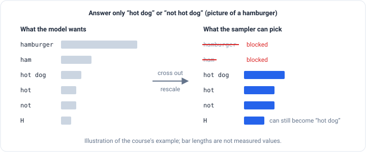

_Based on DeepLearning.AI's
[Getting Structured LLM Output](https://www.deeplearning.ai/courses/getting-structured-llm-output) course, built with
[.txt](https://dottxt.ai/) and taught by Will Kurt and Cameron Pfiffer. This is part 2 of 2.
[Part 1](/engineering/three-ways-to-get-structured-output) explains why programs need structured output and covers the
first two ways to get it._

In [part 1](/engineering/three-ways-to-get-structured-output) we got an AI to fill in a form two ways: let the AI
company enforce it, or check the answer and ask again. Both have the same weakness. They ask the model to behave, then
find out afterwards whether it did.

The third way doesn't ask. It changes what the model is able to write. The course calls it **structured generation**
(you'll also see **constrained decoding**), and uses a library called **Outlines**, made by .txt, the company behind
the course. Keep that in mind when the course praises it.

## How an AI writes, one piece at a time

An AI model doesn't write a whole answer at once. It writes one small piece at a time, called a **token**, which is
usually a word or part of a word. At each step:

1. The model reads everything so far: your question plus whatever it has already written.
2. It gives every possible next token a score. These scores are called **logits**, and they turn into chances: "Here"
   35%, "I" 12%, and so on for tens of thousands of tokens.
3. A **sampler** picks one. A _greedy_ sampler always takes the most likely token. A _random_ sampler rolls dice
   weighted by the chances, so less likely tokens sometimes win.
4. The chosen token is added to the text, and the whole thing repeats until the model picks a special **stop token**.

Structured generation steps in between steps 2 and 3. Before the sampler picks, it **crosses out every token that would
break the format** and shares their chances out among the tokens that are left. The sampler works exactly as before.
It just can't see the forbidden options anymore.

The course's example: show a picture of a hamburger to a model that can see images, and tell it to answer only "hot dog"
or "not hot dog." The model really wants to say "hamburger." Structured generation crosses out `hamburger` and `ham`,
and keeps `hot`, `not` and even a lone `H`, because `H` could still become "hot dog."



It's like a phone keypad where the wrong buttons are physically locked. You can't dial a wrong format, no matter how
hard you try.

The catch is that you need access to those chances. Paid AI services like OpenAI, Anthropic and Google don't share
them, so this works with **open models** you run yourself, such as models downloaded from Hugging Face. (Part 1
mentioned that some AI companies may use this same trick on their own servers.)

Outlines can also be pointed at OpenAI, Anthropic or Gemini, but in that case it isn't doing the blocking. Its own
documentation says it hands the request to the provider's built-in structured output feature, and only the formats that
provider supports will work. Everything in this post that needs regex, choices or custom layouts relies on the first
kind: a model Outlines controls directly. A server you host yourself, such as vLLM, also does the blocking on its side,
so it can support regex too.

## Watching it happen, token by token

The course shows this with **SmolLM2-135M**, a model so small it runs on a laptop CPU and is far too weak to follow
"reply only in JSON" on its own. The form is about as simple as forms get:

```python
import outlines
from pydantic import BaseModel

model = outlines.models.transformers("HuggingFaceTB/SmolLM2-135M-Instruct")

class Person(BaseModel):
    name: str
    age: int

generator = outlines.generate.json(model, Person, sampler=outlines.samplers.greedy())
```

A note on the code: it follows the course, which uses Outlines version 0. Newer versions renamed things. Models load with
`outlines.from_transformers(...)`, and `outlines.Generator(model, Person)` replaces `outlines.generate.json`. The
generator now returns plain text, so you turn it into a `Person` yourself with `Person.model_validate_json(...)`. I only
checked the loading and parsing change against the current docs. The ideas below don't depend on the names.

The prompt was "Give me a person with a name and an age." The result was `Person(name='John', age=30)`, which is the
JSON `{ "name": "John", "age": 30 }`. The interesting part is _how_ the model got there. The course records the chances
at every step, with and without the constraint:


**The first token: the form decides everything.** Left alone, the model wanted to start chatting: `Here` 35.6%, `I`
11.5%, `Meet` 11.5%. ("Here is a person…") None of those can start JSON, so all were crossed out. Only `{` (90.8%) and
`{"` (9.2%) were left.

**The box name: the model mostly knew already.** For the first label, the model gave `name` 67.3% and spread the rest
over things like `user` and `Name`. The constraint pushed `name` to 99.7%. The last 0.3% went to `n`, `na` and `nam`,
which can still grow into "name," so they're allowed.

**The punctuation: the model was already right.** After `"name`, the next piece must be `":`. The model gave it 95.6%
without any help, and 96.1% with it. Small models have seen a lot of JSON.

**The name itself: the constraint does nothing.** Inside the quotes, any text is allowed, so nothing gets crossed out.
`John` was 7.1% both ways, just ahead of `E` at 7.0%. After `John`, the model gave the closing `",` 56.3% and `Do`
26.0%. It nearly wrote "John Doe." Same with the age: `3` was the most likely first digit at 39.3% either way.

**The ending: no extra chatter.** At the end the model wanted `}` 80.7% of the time, and sometimes a comma to keep
going. The constraint made `}` 94.3% (the rest went to `}` with a space before it), and then the stop token 100%. The
model can't add "Hope this helps!"

That middle result answers a common worry, that forcing a format makes the AI dumber. In this example it didn't. The
constraint only locked the parts that were never the model's decision, like braces, quotes and labels, and left the
actual content alone. (The course claims structured generation often scores _better_ on tests. That's .txt's own
finding, and part 1 mentioned others who found the opposite with other methods.)

### When the model wants something you didn't allow

The course's "you try" exercise adds a job box that must be one of a fixed list:

```python
class EmployedPerson(BaseModel):
    name: str
    age: int
    job: Literal['Doctor', 'Basketball Player', 'Welder', 'Dog catcher']
```

At the job box, the model's favorite was `Software` at 74.2%, probably heading for "Software Engineer." That's not on
the list, so it was crossed out. Among the allowed jobs, `Doctor` led at 45.8%, then `B` (the start of "Basketball
Player") at 24.1% and `D` (the start of "Dog catcher") at 23.5%.

Right after `Doctor`, the model wanted to keep going with `of` (61.5%), as in "Doctor of …". The list says the job
ends there, so the closing quote got 99.3%.

This is the clearest picture of what the constraint does. The model still has its preferences. It just has to choose
among the options you allowed.

### A detail: chat templates

When you chat with an AI, your message is secretly wrapped in special markers that tell the model who is talking. For
SmolLM2 it looks like this:

```text
<|im_start|>system
You create users.<|im_end|>
<|im_start|>user
Give me a person with a name and an age.<|im_end|>
<|im_start|>assistant
```

Most libraries add these for you. Outlines doesn't, because it gives you lower-level control, so the course uses a
small helper to add them. If you try Outlines yourself and the answers look strange, check this first.

## How Outlines keeps track: a board game for patterns

Under the hood, Outlines turns every format into a **regular expression** (a regex), the pattern language part 1 used
for zip codes. JSON forms get converted to a regex automatically. Then Outlines turns the regex into a
**finite state machine**.

That sounds scary, but it's a board game. There are a few squares, and arrows between them labeled with letters. You
start on the start square, and each letter you read moves you along an arrow with that letter. If there's no arrow for
the letter, you're stuck. If you finish on a goal square, the text matches.

The course's example pattern is "some A's, then some B's, then some C's, in that order," written `A*B*C*`. Any of the
groups can be empty. `ABC`, `AABCCC`, `C` and even the empty string match. `BA` and `CBA` don't, because a letter came
out of order.


To check whether text matches, you walk through it. To _generate_ text that matches, Outlines runs the same game the
other way around. At each step, it looks at which square it's on, and only the letters with an arrow out of that square
are allowed. Everything else gets crossed out. After writing a `B`, the only arrows out lead to `B` and `C`, so `A`
can never appear again.

Looking up "which arrows leave this square?" is very fast, which is why the course says structured generation adds
almost no time while the model writes.

## Beyond JSON

Since everything becomes a pattern anyway, JSON isn't special. Any format you can describe as a regex works. The course
tries several with the same tiny model, and here's what the notebook produced:

| Format         | What it was told                                  | What it produced                      |
| -------------- | ------------------------------------------------- | ------------------------------------- |
| Choice         | Classify a pizza review: `positive` or `negative` | `positive`                            |
| Phone number   | Rewrite `206-555-1234` as `(XXX) XXX-XXXX`        | `(206) 555-1234`                      |
| Email          | An email for someone at Amazon                    | `Icyblue@amazon.com`                  |
| HTML image tag | An image tag for `big_fish.png` with alt text     | `` |
| Tic-tac-toe    | A game in progress on an ASCII board              | top row `X\|O\|O`, two empty rows     |

A few of these are worth a closer look.

- **A choice makes classification exact.** `outlines.generate.choice(model, ['positive', 'negative'])` means the answer
  is one of those two words, spelled exactly that way. "Positive." with a capital and a period can't happen, so there's
  nothing to clean up.
- **A regex can reformat while it extracts.** The phone number came in with dashes and came out in the requested
  format, because the pattern `\([0-9]{3}\) [0-9]{3}-[0-9]{4}` allows nothing else.
- **The pattern does the layout, the model makes the choices.** The tic-tac-toe regex fixes every `|`, `-` and `+` on
  the board. The 135M model only decides X, O or blank in each of the nine spots, so it can't draw a broken board.

### CSV straight into a spreadsheet

The course also asks for a small CSV inventory table, with a pattern for three columns: a three-letter code, an amount,
and a cost with two decimal places. The output loads straight into pandas:

| Code | Amount | Cost |
| ---- | ------ | ---- |
| CAF  | 4      | 10.0 |
| COK  | 7      | 12.0 |
| ECR  | 5      | 18.0 |

Look at the costs: 10, 12 and 18. That's not a coincidence. The course's pattern has a typo:

```python
r'Code,Amount,Cost\n([A-Z]{3},[1]*[0-9],1]*[0-9]\.[0-9]{2}\n){1,3}'
#                                        ^ should be [1]*
```

A missing `[` turns "an optional 1" into "a required 1," so every price must be between 10.00 and 19.99. I checked it
with Python's `re`: `ABC,5,12.50` matches and `ABC,5,7.50` doesn't. The model followed the broken rule perfectly, and
nothing complained.

That's the flip side of a guarantee. A wrong rule gets followed just as faithfully as a right one. The course's own tip
is the fix: before you give a pattern to a model, test it against an example you know is good with `re.search`. It does
this for the image tag. Testing it against an example you know is _bad_ as well would have caught the CSV typo.

### Shaping the reasoning, not just the answer

The last example uses GSM8K, a well-known set of grade-school math word problems. Answers follow a pattern:

```text
Reasoning: Tom started with 3 cucumbers, then received 2 more. This means he has 5 cucumbers.
So the answer is: 5
```

Writing that regex by hand would be painful, so Outlines has building blocks for it:

```python
from outlines.types import sentence, digit
from outlines.types.dsl import to_regex

reasoning = "Reasoning: " + sentence.repeat(1, 2)
answer = "So the answer is: " + digit.repeat(1, 4)
pattern = to_regex(reasoning + "\n" + answer)
```

Asked "Sally has 5 apples, then received 2 more, how many apples does Sally have?", the tiny model wrote:

```text
Reasoning: Sally started with 5 apples, then received 2 more. This means she has 5 + 2 = 7 apples.
So the answer is: 7
```

The pattern makes the model **reason before it answers**, because "So the answer is" can't come first. Reading the
answer out afterwards is trivial.

One more pattern worth testing: `sentence` becomes `[A-Z].*\s*[.!?]`, and `.*` means "anything." So one "sentence" can
quietly contain several. I checked: a reasoning line with five sentences still matches the "one or two sentences"
pattern. Here it doesn't matter, but if you were counting on a length limit, you wouldn't have one.

### Homework: hot dog or not

The course ends with an exercise. A small model that can see images, SmolVLM-256M, gets five pictures and is told to
reply with only "hotdog" or "not a hotdog." Without any constraint, the notebook shows what you'd fear:

- `Hotdog.` three times, with a capital letter and a period
- `Not a hotdog.` once
- `This airplane is flying in the sky.` for the last picture

The labels drifted, and the last one ignored the instructions completely. For a real system that sorts thousands of
images, every one of those needs cleanup code. The exercise is to fix it with `outlines.generate.choice` and the two
allowed labels, which makes all three problems impossible. The notebook leaves that part to the reader, so there's no
result to show here, but after everything above you can predict the format of the answer. Whether it's the _right_
label is a different question.

## Correct shape isn't correct answer

All three ways in this series solve the same problem: making the answer **fit the form**. Structured generation solves
it best, because a broken form can't be written at all. None of them make the answer **true**.

`Person(name='John', age=30)` is perfect JSON and describes nobody. A hot dog classifier that always answers in the
right format can still call a hamburger a hot dog. The CSV table was well-formed and had prices forced into the wrong
range. Structured output turns a messy problem into a tidy one. You still have to check the facts.

## Which way should you use?

|                             | Way 1: AI company      | Way 2: Check and retry          | Way 3: Structured generation                      |
| --------------------------- | ---------------------- | ------------------------------- | ------------------------------------------------- |
| Works with paid AI services | Yes, that company only | Yes, almost any                 | No, needs a model you run (or a server like vLLM) |
| Formats                     | Part of JSON           | All of JSON + Pydantic checks   | Anything a regex can describe                     |
| Can the format break?       | Rarely, with an error  | Yes, after it runs out of tries | No                                                |
| Extra cost                  | None                   | A full request for every retry  | Almost none, per the course                       |

- **Use Way 1** if you use one AI company and your form is simple.
- **Use Way 2** if you need custom checks or want to switch between companies.
- **Use Way 3** if you run your own model, or if the output isn't JSON at all: a label, a phone number, a CSV row, a
  game board. If you're stuck with OpenAI, Anthropic or Gemini, that means Way 1 or Way 2, even if Outlines is the
  library you call them through.

This is the course's "journey": from chatting and hoping, to letting a company enforce JSON, to retrying, to controlling
the model's choices directly. The picture I'd keep from it is the very first chart. Left alone, the model's favorite
first word was "Here." It was never trying to fill in your form. It was trying to write you a friendly sentence, and
each way in this series is just a different place to stop it.
