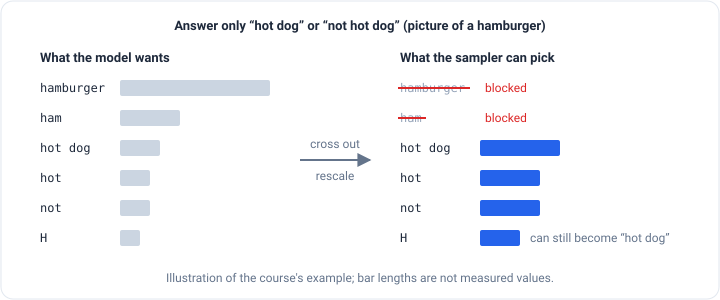

_Based on DeepLearning.AI's
[Getting Structured LLM Output](https://www.deeplearning.ai/courses/getting-structured-llm-output) course, built with
[.txt](https://dottxt.ai/) and taught by Will Kurt and Cameron Pfiffer. This is part 2 of 2.
[Part 1](/engineering/three-ways-to-get-structured-output) explains why programs need structured output and covers the
first two ways to get it._

In [part 1](/engineering/three-ways-to-get-structured-output) we got an AI to fill in a form two ways: let the AI
company enforce it, or check the answer and ask again. Both have the same weakness. They ask the model to behave, then
find out afterwards whether it did.

The third way doesn't ask. It changes what the model is able to write. The course calls it **structured generation**
(you'll also see **constrained decoding**), and uses a library called **Outlines**, made by .txt, the company behind
the course. Keep that in mind when the course praises it.

## How an AI writes, one piece at a time

An AI model doesn't write a whole answer at once. It writes one small piece at a time, called a **token**, which is
usually a word or part of a word. At each step:

1. The model reads everything so far: your question plus whatever it has already written.
2. It gives every possible next token a score. These scores are called **logits**, and they turn into chances: "Here"
   35%, "I" 12%, and so on for tens of thousands of tokens.
3. A **sampler** picks one. A _greedy_ sampler always takes the most likely token. A _random_ sampler rolls dice
   weighted by the chances, so less likely tokens sometimes win.
4. The chosen token is added to the text, and the whole thing repeats until the model picks a special **stop token**.

Structured generation steps in between steps 2 and 3. Before the sampler picks, it **crosses out every token that would
break the format** and shares their chances out among the tokens that are left. The sampler works exactly as before.
It just can't see the forbidden options anymore.

The course's example: show a picture of a hamburger to a model that can see images, and tell it to answer only "hot dog"
or "not hot dog." The model really wants to say "hamburger." Structured generation crosses out `hamburger` and `ham`,
and keeps `hot`, `not` and even a lone `H`, because `H` could still become "hot dog."



The catch is that you need access to those chances. Paid AI services like OpenAI, Anthropic and Google don't share
them, so this works with **open models** you run yourself, such as models downloaded from Hugging Face.

## Watching it happen, token by token

The course shows this with **SmolLM2-135M**, a model so small it runs on a laptop CPU and is far too weak to follow
"reply only in JSON" on its own. The form is about as simple as forms get:

```python
import outlines
from pydantic import BaseModel

model = outlines.models.transformers("HuggingFaceTB/SmolLM2-135M-Instruct")

class Person(BaseModel):
    name: str
    age: int

generator = outlines.generate.json(model, Person, sampler=outlines.samplers.greedy())
```

(The code follows the course, which uses Outlines version 0. Newer versions renamed some functions, but the ideas are the
same.)

The prompt was "Give me a person with a name and an age." The result was `Person(name='John', age=30)`. The interesting
part is _how_ the model got there. The course records the chances at every step, with and without the constraint:


**The first token: the form decides everything.** Left alone, the model wanted to start chatting: `Here` 35.6%, `I`
11.5%, `Meet` 11.5%. ("Here is a person…") None of those can start JSON, so all were crossed out. Only `{` (90.8%) and
`{"` (9.2%) were left.

**The name itself: the constraint does nothing.** Inside the quotes, any text is allowed, so nothing gets crossed out.
`John` was 7.1% both ways. Same with the age: `3` was the most likely first digit at 39.3% either way.

**The ending: no extra chatter.** After the closing `}`, the stop token was the only option. The model can't add "Hope
this helps!"

That middle result answers a common worry, that forcing a format makes the AI dumber. In this example it didn't. The
constraint only locked the braces, quotes and labels, and left the actual content alone.

### When the model wants something you didn't allow

The course's "you try" exercise adds a job box that must be one of a fixed list:

```python
class EmployedPerson(BaseModel):
    name: str
    age: int
    job: Literal['Doctor', 'Basketball Player', 'Welder', 'Dog catcher']
```

At the job box, the model's favorite was `Software` at 74.2%, probably heading for "Software Engineer." That's not on
the list, so it was crossed out. Among the allowed jobs, `Doctor` led at 45.8%, then `B` (the start of "Basketball
Player") at 24.1% and `D` (the start of "Dog catcher") at 23.5%.

The model still has its preferences. It just has to choose among the options you allowed.

## How Outlines keeps track: a board game for patterns

Under the hood, Outlines turns every format into a **regular expression** (a regex), the pattern language part 1 used
for zip codes. Then it turns the regex into a **finite state machine**.

That sounds scary, but it's a board game. There are a few squares, and arrows between them labeled with letters. Each
letter you read moves you along an arrow with that letter. If there's no arrow for the letter, you're stuck.

The course's example pattern is "some A's, then some B's, then some C's, in that order," written `A*B*C*`. `ABC`,
`AABCCC` and `C` match. `BA` doesn't, because a letter came out of order.


To _generate_ matching text, Outlines plays the game as the model writes. At each step, only the letters with an arrow
out of the current square are allowed, and everything else gets crossed out. Looking that up is very fast, which is why
the course says structured generation adds almost no time.

## Beyond JSON

Since everything becomes a pattern anyway, JSON isn't special. Any format you can describe as a regex works. The course
tries several with the same tiny model:

| Format         | What it was told                                  | What it produced                      |
| -------------- | ------------------------------------------------- | ------------------------------------- |
| Choice         | Classify a pizza review: `positive` or `negative` | `positive`                            |
| Phone number   | Rewrite `206-555-1234` as `(XXX) XXX-XXXX`        | `(206) 555-1234`                      |
| Email          | An email for someone at Amazon                    | `Icyblue@amazon.com`                  |
| HTML image tag | An image tag for `big_fish.png` with alt text     | `` |
| Tic-tac-toe    | A game in progress on an ASCII board              | top row `X\|O\|O`, two empty rows     |

- **A choice makes classification exact.** The answer is one of the allowed words, spelled exactly that way.
  "Positive." with a capital and a period can't happen, so there's nothing to clean up.
- **The pattern does the layout, the model makes the choices.** The tic-tac-toe regex fixes every `|`, `-` and `+` on
  the board. The model only decides X, O or blank in each spot, so it can't draw a broken board.

One warning: a wrong rule gets followed just as faithfully as a right one. The course's CSV pattern had a typo that
forced every price to start with a 1, and the model obeyed it without complaint. Test your pattern on a good example and
a bad one before you hand it to a model.

### Shaping the reasoning, not just the answer

The last example uses GSM8K, a well-known set of grade-school math word problems. Outlines has building blocks for
writing the pattern:

```python
from outlines.types import sentence, digit
from outlines.types.dsl import to_regex

reasoning = "Reasoning: " + sentence.repeat(1, 2)
answer = "So the answer is: " + digit.repeat(1, 4)
pattern = to_regex(reasoning + "\n" + answer)
```

Asked "Sally has 5 apples, then received 2 more, how many apples does Sally have?", the tiny model wrote:

```text
Reasoning: Sally started with 5 apples, then received 2 more. This means she has 5 + 2 = 7 apples.
So the answer is: 7
```

The pattern makes the model **reason before it answers**, because "So the answer is" can't come first.

## Correct shape isn't correct answer

All three ways in this series make the answer **fit the form**. Structured generation does it best, because a broken
form can't be written at all. None of them make the answer **true**. `Person(name='John', age=30)` is perfect JSON and
describes nobody. You still have to check the facts.

## Which way should you use?

|                             | Way 1: AI company      | Way 2: Check and retry          | Way 3: Structured generation                      |
| --------------------------- | ---------------------- | ------------------------------- | ------------------------------------------------- |
| Works with paid AI services | Yes, that company only | Yes, almost any                 | No, needs a model you run (or a server like vLLM) |
| Formats                     | Part of JSON           | All of JSON + Pydantic checks   | Anything a regex can describe                     |
| Can the format break?       | Rarely, with an error  | Yes, after it runs out of tries | No                                                |
| Extra cost                  | None                   | A full request for every retry  | Almost none, per the course                       |

- **Use Way 1** if you use one AI company and your form is simple.
- **Use Way 2** if you need custom checks or want to switch between companies.
- **Use Way 3** if you run your own model, or if the output isn't JSON at all: a label, a phone number, a CSV row, a
  game board.

The picture I'd keep from this course is the very first chart. Left alone, the model's favorite first word was "Here."
It was never trying to fill in your form. Each way in this series is just a different place to stop it.
