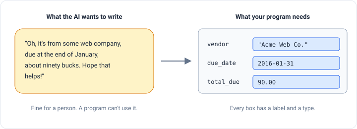
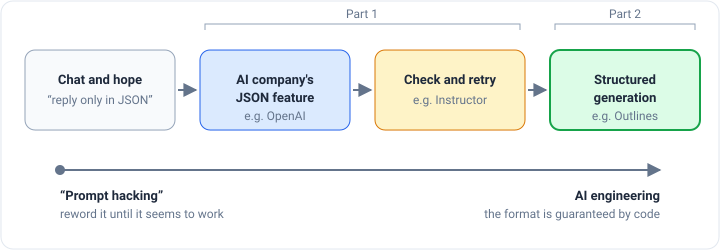
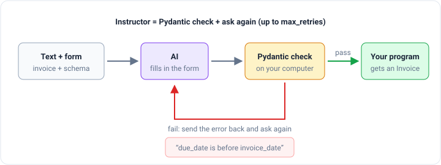

_Based on DeepLearning.AI's
[Getting Structured LLM Output](https://www.deeplearning.ai/courses/getting-structured-llm-output) course, built with
[.txt](https://dottxt.ai/) and taught by Will Kurt and Cameron Pfiffer. This is part 1 of 2.
[Part 2](/engineering/structured-generation-with-outlines) covers the third way, structured generation._

Ask a friend to read an invoice and tell you who sent it, when it's due and how much it costs. They'll say something
like "Oh, it's from some web company, due at the end of January, about ninety bucks." That's a fine answer for a person.
It's a terrible answer for a computer program, which wants three boxes filled in: **vendor**, **due date**, **total**.

AI models talk like your friend. They write sentences. If your program needs to save the answer in a spreadsheet, sort
it by date, or decide whether to send an alert, a sentence is useless until somebody digs the facts back out of it.

Getting an AI to fill in boxes instead of writing sentences is called **structured output**. The most common format
for those boxes is **JSON**, a plain-text way of writing labels and values inside curly braces, like
`{"name": "Dolly Parton", "age": 79}`.



## Why not just read the sentence?

The course makes this concrete with a **social media agent**: a program that reads posts people tag your company in,
asks an AI to write a reply, and posts that reply for you.

The first version is simple. The AI writes a reply, and your program passes it along. But you still need to pull the
reply out of whatever the AI wrote, so you write a small **parser**, a few rules that cut the useful part out of the
text. Parsers like this take a long time to write and break easily, because the AI keeps phrasing things in ways you
didn't expect.

Then your boss asks for one small change: **if the post is a complaint, send it to customer support instead of replying
automatically.** Now your parser has to figure out two things from free text: is this a complaint, and what's the
reply? Every new feature makes the parser messier.

If the AI answers with a predictable form instead, the change is one line. The form has a `complaint` box and a
`response` box, and your program checks `if complaint:` the same way it checks any other true-or-false value.


## The three ways, and the journey between them

The course sorts the ways to get structured output into three groups, and presents them as steps on a journey from
"prompt hacking" (rewording your request until it seems to work) toward real engineering:



1. **Let the AI company enforce it.** Big providers like OpenAI accept a form along with your question and promise to
   fill it in.
2. **Check the answer and ask again.** A library like Instructor checks the AI's answer on your computer. If it's
   wrong, it sends the AI the error and asks for a fix.
3. **Make wrong answers impossible to type.** This is called **structured generation**. It reaches inside the model
   and blocks every word that would break the form, before the model can pick it.

This post covers the first two. Part 2 covers the third, which is where the course spends most of its time.

## First, describe the form

Every method starts with writing down what the form looks like. The official way to describe the shape of a JSON form
is a **JSON Schema**. Here's one for a person:

```json
{
  "properties": {
    "name": { "title": "Name", "type": "string" },
    "age": { "title": "Age", "type": "integer" },
    "email": { "anyOf": [{ "type": "string" }, { "type": "null" }], "title": "Email" }
  },
  "required": ["name", "age"],
  "title": "User",
  "type": "object"
}
```

That's a lot of punctuation for three boxes, and real forms are much bigger. So in Python, people describe the form
with **Pydantic** instead, a library that checks data has the right shape. You write a short class and Pydantic
produces the schema for you:

```python
from typing import Optional
from pydantic import BaseModel

class User(BaseModel):
    name: str                    # any text
    age: int                     # a whole number
    email: Optional[str] = None  # text, or nothing at all
```

The words `str`, `int` and `Optional[str]` are **types**: they say what kind of value may go in each box. `= None`
means the box can be left out.

## Way 1: Let the AI company enforce it

With OpenAI's Python library, you hand over the class and get back a filled-in `User`, not text:

```python
completion = client.beta.chat.completions.parse(
    model="gpt-4o-mini",
    messages=[
        {"role": "system", "content": "You are a helpful assistant."},
        {"role": "user", "content": "Make up a user."},
    ],
    response_format=User,
)
user = completion.choices[0].message.parsed
```

In the course notebook this came back as `User(name='Alice Johnson', age=34, email='alice.johnson@example.com')`. The
result is a real Python object, so `user.age` is a number you can do math with.

### The social media agent, rebuilt

Here's the form for the social media agent:

```python
from typing import List, Literal, Optional

class Mention(BaseModel):
    product: Literal['app', 'website', 'not_applicable']
    sentiment: Literal['positive', 'negative', 'neutral']
    needs_response: bool
    response: Optional[str]
    support_ticket_description: Optional[str]
```

`Literal[...]` means "pick exactly one of these words." `bool` means true or false. A single question to the AI now
does four jobs at once: it says which product the post is about, judges the mood, decides whether to reply and writes
the reply, and decides whether to open a support ticket.

The notebook ran three posts through it and turned the results straight into a table:

| Post                                                       | product          | sentiment | needs_response | support ticket                            |
| ---------------------------------------------------------- | ---------------- | --------- | -------------- | ----------------------------------------- |
| "@techcorp your app is amazing! The new design is perfect" | `app`            | positive  | `True`         | none                                      |
| "@techcorp website is down again, please fix!"             | `website`        | negative  | `True`         | "User reported that the website is down." |
| "hey @techcorp you're so evil"                             | `not_applicable` | negative  | `False`        | none                                      |

The "don't reply to bait" rule was one sentence in the instructions, and it came back as a plain `False` your program
can act on. The instructions also had a personality setting. Switching it from "friendly" to "rude" turned the reply to
the first post into "Thanks for the compliment! It's about time someone appreciated good design around here." Same
form, different voice.

### The order of the boxes matters

The AI fills in the form from top to bottom, one word at a time, and it can see everything it has already written. The
course uses this on purpose with a form for _fake customer posts_ that puts `user_mood` and an `internal_monologue`
list **above** the `message` box:

```python
class UserPostWithExtras(BaseModel):
    user_mood: Literal["awful", "bad", "evil"]
    product: Literal['app', 'website', 'not_applicable']
    sentiment: Literal['positive', 'negative', 'neutral']
    internal_monologue: List[str]
    message: str
```

In the notebook the AI first wrote the mood `awful` and thoughts like "This app is really frustrating me." Only then did
it write the message: "I've been having constant issues with the app crashing on my phone…" Fed back into the agent,
that post got an apology and the ticket "User reported constant app crashes on their phone, requesting a fix."

It's like making students show their work before the final answer. Put the "thinking" boxes first. If you put them
after the answer, the AI is just explaining a choice it already made.

### How do the AI companies do it?

The course lists the tricks providers use, and you usually can't tell which one you're getting:

- **Function calling** (or **tool use**): the model was trained to produce JSON when it wants to "call" a tool, and the
  form is dressed up as a tool.
- **JSON mode**: the model was trained to answer in JSON when asked to.
- **Constrained decoding**: the provider blocks invalid words as the model writes. This is the technique Part 2 covers.
- Something else they haven't told anyone about.

### The good and the bad

The good part is that it's easy. If you already use OpenAI, it's a few extra lines, and the providers keep improving it.

The course lists four problems:

- **You're tied to one company.** Code written for OpenAI's version needs rewriting to use someone else's.
- **Results can be inconsistent**, depending on the provider.
- **The effect on answer quality is unclear.** Some people have found that forcing a format makes answers worse on
  tests. The course says this isn't proven, but it's a worry.
- **Only part of Pydantic is allowed.** At the time of the course, OpenAI rejected `date` types and pattern rules like
  "must look like an email address." You write a rich form, and the provider only accepts a simpler one.

## Way 2: Check the answer, and ask again

This is what the library **Instructor** does. The course calls it a **re-prompting** library. It sends your form to the
AI, then checks the answer on your own computer using Pydantic. If a box is wrong, it sends the answer back to the AI
along with the exact error message and asks for a fix. Think of a teacher handing back homework with red marks on it.



Pydantic and Instructor do different jobs. Pydantic on its own never talks to an AI. It only checks data you already
have. Instructor is the wrapper that does the asking, and the asking again. You could write that loop yourself in
about fifteen lines. Instructor saves you the trouble.

### One set of code for many AI companies

Most AI providers copy OpenAI's way of sending requests, so OpenAI's own Python library can talk to them if you change
the web address it sends to. The course uses this to reach **Together AI**, a company that hosts open models like
Meta's Llama but doesn't offer a structured output feature of its own:

```python
import instructor
from openai import OpenAI

together_client = OpenAI(base_url="https://api.together.xyz/v1", api_key=...)
instructor_client = instructor.from_openai(together_client)
```

Wrapping the client is the only change. After that you ask for a `response_model` and get back an object:

```python
class Greeting(BaseModel):
    hello: str

instructor_client.chat.completions.create(
    model="meta-llama/Llama-3.3-70B-Instruct-Turbo",
    messages=[{"role": "user", "content": "sup"}],
    response_model=Greeting,
)
```

Watch the name: OpenAI calls this setting `response_format`, Instructor calls it `response_model`. (And the word
_Instruct_ in a model's name has nothing to do with Instructor. It means the model was trained to follow instructions
like a chatbot.)

### All of Pydantic is allowed

Because the checking happens on your computer, every Pydantic feature works, including the ones OpenAI rejected. The
course's example turns an event description into a calendar entry:

```python
from datetime import date
from typing import List
from pydantic import BaseModel, Field

class Person(BaseModel):
    name: str

class CalendarEvent(BaseModel):
    name: str
    date: date                                   # a real date
    participants: List[Person]
    address_number: str
    street_name: str
    city_name: str
    state_code: str = Field(pattern=r'[A-Z]{2}') # exactly two capital letters, like OR
    zip_code: str = Field(pattern=r'\d{5}')      # exactly five digits
```

The `pattern=` parts are **regular expressions**, a mini-language for describing what text must look like. `[A-Z]{2}`
means "two capital letters." `\d{5}` means "five digits." If the AI writes `Oregon` or a four-digit zip code, the check
fails and Instructor asks again.

`participants` is a list of `Person` rather than a list of names. That's ordinary good programming: when you later want
each person's email, you add one line to `Person`.

The course fed this the sentence "Alice and Bob are going to a science fair on Friday, January 2024… at Hazeldale
Elementary School at 20080 SW Farmington Road in Beaverton Oregon." The description never mentions a zip code, but the
form has a box for one, so the model has to come up with something. Asking for a box is a way of asking for
information. Just remember that a made-up zip code passes the five-digit check whether it's right or not.

### The bad part: retries cost money and time

The course is honest about the downsides:

- **Retries are expensive.** Every retry resends the whole conversation, so each failed try costs a full request's worth
  of tokens (the small chunks of text AI companies charge by). Your user waits through every one.
- **It can still fail.** There's no guarantee the AI ever gets it right.
- **It's hard to see what happened.** Instructor doesn't show you how many tries it took. The course had to add its own
  counter to find out.
- **It only works with chat-style models** that already support function calling or JSON mode.

The course demonstrates the failure on purpose. The form asks for three simple values:

```python
class Complicated(BaseModel):
    a: Literal["cat", "dog", "hat"]
    b: int
    c: bool
```

The user asks for "a short essay on Dolly Parton," and the system prompt says "Don't give me what I want." With
`max_retries=3`, Instructor tries three times in total, gets an essay each time, and gives up with an
`InstructorRetryException`. Three paid requests, no answer. When the prompt simply asks for a, b and c, it works on the
first try.

That example is rigged, but the course's point holds. If you call a model thousands of times, some calls will fail by
chance, and each one costs you extra tokens and waiting time.

## Which one should you use?

|                                | Way 1: AI company      | Way 2: Check and retry          |
| ------------------------------ | ---------------------- | ------------------------------- |
| Works with paid AI services    | Yes, that company only | Yes, almost any of them         |
| Dates, patterns, custom rules  | Limited                | Everything Pydantic can check   |
| Can the answer break the form? | Rarely, with an error  | Yes, after it runs out of tries |
| Extra cost                     | None                   | A full request for every retry  |

- **Start with Way 1** if you use one provider and your form is simple.
- **Use Way 2** when you need dates, patterns or your own rules, or want to switch providers easily. Count your
  retries.

One thing neither way does: make sure the answer is **true**. A form that passes every check can still hold the wrong
company name or a made-up zip code. Structured output turns a messy problem into a tidy one, but you still have to check
the facts.

Both ways also share a deeper limit: they ask the model to behave, then check whether it did. The course argues that the
next step is to stop asking, and to make a broken form impossible for the model to write at all.
[Part 2](/engineering/structured-generation-with-outlines) shows how that works, one token at a time.
